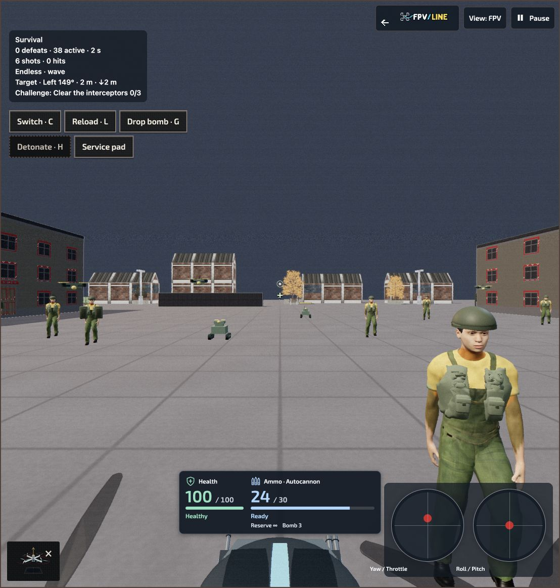

# FPV analog video, black props and restored combat vitals

Date: 2026-10-20  
Workspace: `go_test_radio_fix`  
Local preview: http://127.0.0.1:8768/optional-practice/fpv-worlds/index.html?lang=en

## Delivered

- Pause → Camera view now offers **Analog FPV video** and a **0–100% Video interference** slider. Defaults are Off and 35%; preferences persist alongside the existing camera settings.
- A single optional camera pass combines animated grain, scan lines, horizontal interference, colour bleed and faint ghosting. The HUD remains sharp. Chase/Overview bypass the effect. Reduced motion keeps the noise still; accepted simulation ticks drive animation.
- The optional foreground uses black, three-blade, ten-inch props with curved blade geometry and bounded motion blur. Motors, hubs and arms stay outside the camera layer. Complete aircraft presets retain their original appearance and physical configuration.
- A shared compact health/ammunition panel sits above the cropped drone cowl and remains available when props are hidden. It shows health, magazine, reserve, reload/recharge and payload information.
- Fixed the missing vitals in Survival and the other combat activities. The shared panel had no positioning styles, leaving it below the full-height canvas inside a clipped viewport. Canonical styles now position it over the scene and are included in generated presentation assets.
- Arm/Resume has a separate row above vitals when ready/paused. Narrow-view and short-landscape rules preserve space for existing controls. The existing lifetime counter cannot create an unintended grid row.

## Verification

- All **125 tests passed** across `fpv-combat-vitals.test.mjs`, `fpv-flight-ui.test.mjs` and `fpv-aircraft-renderer.test.mjs`.
- Coverage includes all five combat activities, health display preferences, ammo/reload/payload states, hidden/restored panels, settings persistence and storage failures, reduced motion, camera gating in native/regional views, resource disposal, black foreground props, preserved complete-aircraft presets, and camera framing.
- In-app browser: Survival and Target hunting visibly showed live health and ammunition. Firing decreased ammunition; reloading displayed progress. Analog at 35% and 100% rendered successfully; Chase remained clear; returning to FPV restored the effect. Off returned the clear feed. No console warnings or errors were reported during the checked preview.
- Browser ready-state check at 1108×1163 confirmed a clear gap between Arm/Resume and the HUD. Responsive rules are covered by source contracts; additional physical mobile-device inspection was not performed.
- Lint and `git diff --check` passed. Generated presentation assets passed the byte-identical check.
- Physical-radio actions were not requalified in this visual pass. USB radio input was restored afterward; the SIM was left paused. Analog was returned to Off with strength 35%.

## Package policy

All three working-tree package candidates remained inside their existing limits; no additional packaged files were introduced.

| Package | Runtime files / bytes | Source files / bytes | Source-input headroom |
|---|---:|---:|---:|
| Flight gym | 95 / 3,806,016 | 97 / 3,840,876 | 3,353,491 bytes |
| Academy | 145 / 12,087,094 | 147 / 12,129,045 | 2,151 bytes |
| Worlds | 208 / 19,291,051 | 210 / 19,341,279 | 488,334 bytes |

The package evidence uses synthetic commit/tree bindings for working-tree measurement and is not publication qualification. Academy's source-input margin remains narrow.

## Design references and limits

- [Liftoff's analog camera effect](https://www.liftoff-game.com/news/milestone-060-released) and [its subsequent noise refinement](https://www.liftoff-game.com/news/update-061-released) informed the configurable analog presentation.
- [Betaflight OSD](https://betaflight.com/docs/wiki/app/osd-tab) informed the separation of readable flight telemetry from the camera image.
- [Three.js post-processing](https://threejs.org/manual/pages/how-to-use-post-processing.html) and [colour management](https://threejs.org/manual/pages/color-management.html) informed the single final output transform.

The effect is cosmetic and does not simulate actual radio-link reliability. It uses one additional pass with a camera buffer capped at 1920 pixels on its longest side. GPUs without float colour rendering use an unsigned-byte fallback that can reduce highlight range. GPU timing, a full performance stress run and real analog-camera perceptual matching were not measured in this pass.
