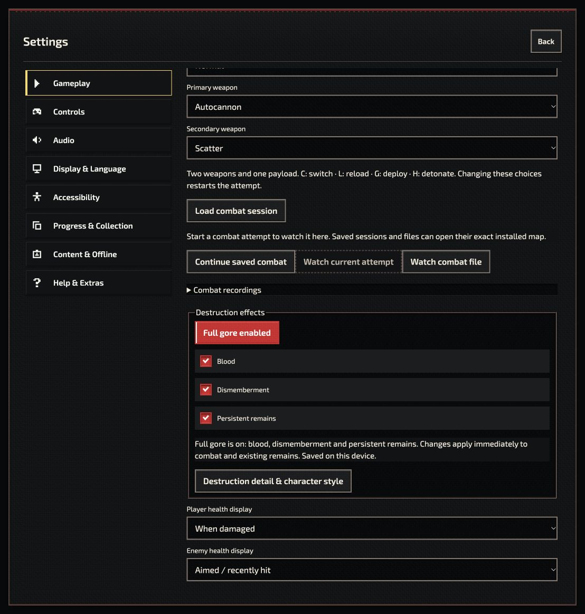

# Combat settings follow-up — 20 October 2026

Scope: the six controls reported in the user's screenshot, in the isolated local workspace. No commit, push or publication was performed.

## Findings and fixes

| Control | Finding | Delivered behavior |
| --- | --- | --- |
| Full gore | Preset updated hidden Display controls without indicating its state; the user's three flags were already enabled. | Visible enabled state, Blood/Dismemberment/Persistent remains checkboxes, immediate shared updates, saved/session-only status and a link to graphics/detail controls. |
| Load combat session | No-current-map paths could silently discard a selected file; errors appeared behind Settings. | Real file picker, exact available map resolution, visible loading/error/cancellation feedback. |
| Continue saved combat | Required the user to find the original map first. | Opens the exact available native or installed regional map; missing saves/revisions explain the problem. |
| Watch current attempt | Initially enabled without a combat attempt and could silently return. | Availability follows the actual attempt; preparation/error status is visible. |
| Watch combat file | File errors were hidden and map selection was manual. | Real picker, clear invalid-file feedback and exact-map playback from home. |
| Combat recordings | An incomplete newest row could be selected despite playable older rows. | Completed recording preferred initially, explicit incomplete/empty/error states, protected async actions and stable export filename. |

Full gore remains an idempotent preset. Individual switches can disable effects; graphics quality and character art remain independently selected. No destruction records or existing recordings were deleted.

## Verification

- **180/180 UI and lifecycle tests**, no skips: mounted visible controls, two-way preference synchronization, refresh/storage behavior, renderer preference callback, picker/cancel/invalid-file paths, native Load/Continue/Watch from home, missing exact revision preserving the current flight, and archive states.
- **93/93 presentation tests**, no skips: preferences, controls, detailed organic remains, appearance batching and shared presentation.
- Changed JavaScript lint and formatting pass. Generated reaction runtime remains byte-identical to fresh deterministic projection.
- One broader display-host test could not load because this sparse checkout omits `authoring/motion-lab/animation.mjs`. It is excluded from the 273 passing checks above.
- All three runtime/source package envelopes pass; see [package receipt](overhaul-combat-settings-packages.json). This working-tree candidate uses synthetic source identities and is not release qualification.

Actual local browser journeys used production controls:

1. Disabled all three effects, restored them with Full gore, checked Display synchronization in both directions, and refreshed to confirm persistence.
2. Opened the Load file picker and selected an invalid file; Settings displayed the error.
3. Continued the saved native Gantry express attempt from home at 37.5 seconds.
4. Prepared, resumed and paused its current-attempt playback.
5. Opened an installed Railway Valley recording from the archive; the exact regional map loaded in paused, no-reward playback at 0/16 seconds.
6. Exported that recording, then opened the downloaded file through Watch combat file and reached the same playback.
7. Selected an incomplete recording and confirmed the explicit missing-ending explanation and disabled Watch action.
8. Left the local app in Gameplay settings with Full gore enabled and no active playback.

The screenshot records the final visible controls. These checks do not replace physical-radio, sustained-performance or human gameplay qualification.

