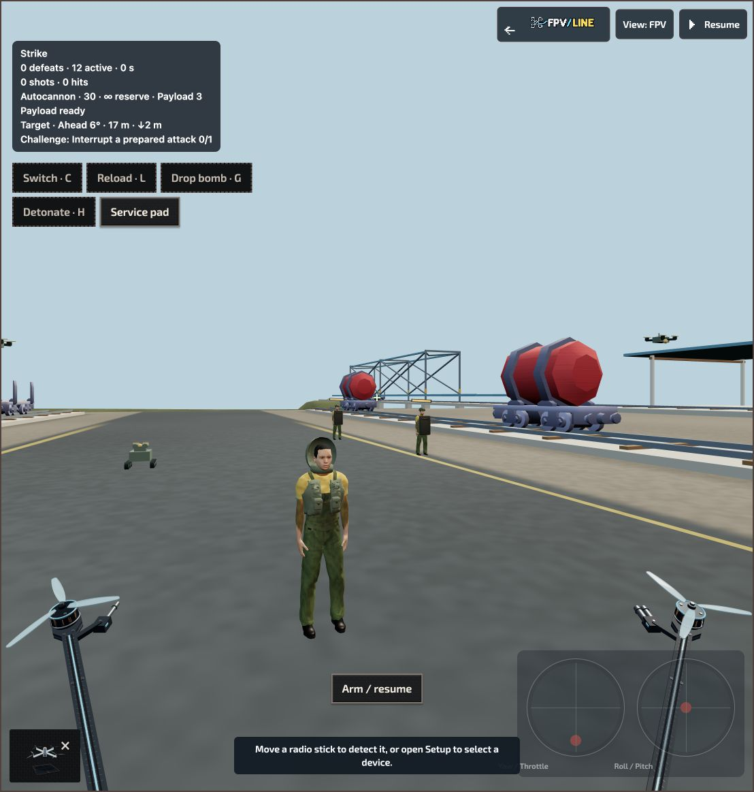
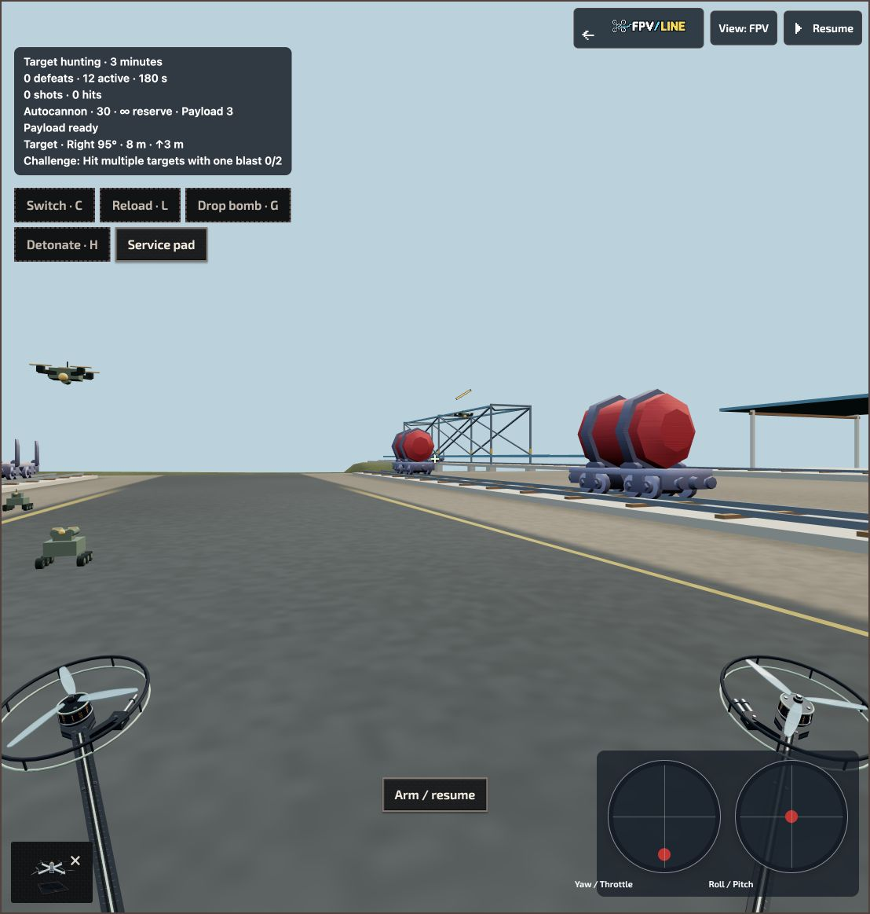

# Peripheral FPV aircraft presentation

20 October 2026. Local working-tree implementation in `go_test_radio_fix`.

## Correction

The props option previously revealed the complete world aircraft immediately around the FPV camera. Its body, arms and nearby polygons occupied much of the screen, and enabling the option also moved the camera.

FPV now uses a dedicated presentation of the front motors, propellers, arms and equipped weapon mounts. The full aircraft remains available in Chase and Overview. The center stays clear across the supported fields of view and screen shapes; toggling props does not move the camera or change aim.

The new geometry includes pitched curved blades, vented motor bells, copper windings, bolts, wiring and layered slim arms. Physical aircraft presets supply blade count, rotation direction and ducted protection. Cosmetic Racer, Freestyle and Utility appearances supply their corresponding treatment; physical duct geometry takes precedence. The current game has no separate player armor parameter, so the visible protection follows its existing guards and aircraft configuration. Combat mounts follow the two equipped weapons, with firing feedback on the active weapon.

A separate depth-cleared presentation pass prevents nearby floors or walls cutting through the props. Lighting follows the world. Shadows are disabled for these foreground parts, and reduced-motion mode disables their rotation and blur. Rebuilding or disposing the renderer releases their resources. Plain presentation uses 22 visible mesh draws; guards, both weapon mounts and flashes bring the ceiling to 34.

## References and application

- [Liftoff's experimental update](https://www.liftoff-game.com/news/experimental-branch-update) describes hiding camera-intersecting parts and optional propeller visibility. This informed the dedicated peripheral presentation and unchanged camera.
- [Liftoff 1.4.10](https://www.liftoff-game.com/news/update-1410-released) introduced translucent Gemfan propellers. Curved, translucent blades and restrained motion blur provide a similar readability cue here.
- [iFlight Nazgul DC5 ECO](https://iflight-rc.eu/en-gb/products/nazgul-dc5-o4-eco-v1-1-6s-hd) uses DeadCat geometry for a clear camera view. This informed keeping the central sightline open.
- [DJI Avata 2](https://www.dji.com/avata-2) provides a compact integrated-guard reference for protected aircraft.

These are design references. The implementation uses original procedural geometry; no external model or texture was copied.

## Verification

- Aircraft renderer: **19/19 tests passed**. Covers all catalogue presets, three cosmetic skins, FOV 60/82/120, aspect ratios 0.6/1/16:9/21:9, protected center, clipping bounds, camera invariance, blade configuration, guards, weapon pairs, flash cleanup, pause, reduced motion and view changes.
- Aircraft preview and flight UI: **85/85 tests passed**.
- Prettier, ESLint and scoped diff whitespace checks passed.
- Generated reaction runtime remains byte-identical: 42 modules and 24 recordings.
- Browser inspection in native Signals and platforms and regional Railway Valley: props framing, Utility guards, Racer geometry, props toggle, firing and pause checked. No browser error entries in the final observation.
- User preferences restored to Racer, USB radio, Acro and Strike; props remain enabled. Radio calibration was not edited.

This is bounded local verification. A physical-radio retest and sustained GPU/performance benchmark were not repeated for this visual change.

## Package measurements

Complete runtime/source closures, including existing task changes:

| Package | Runtime files / bytes | Source files / bytes | Input bytes / limit |
| --- | ---: | ---: | ---: |
| Flight gym | 95 / 3,751,549 | 97 / 3,786,409 | 4,980,650 / 8,388,608 |
| Academy | 145 / 11,977,737 | 147 / 12,019,687 | 13,192,302 / 13,303,808 |
| Worlds | 208 / 19,158,123 | 210 / 19,208,350 | 20,350,260 / 20,971,520 |

All remain within their existing file and byte policies. Worlds reaches its 210-file source limit; Academy has 111,506 input bytes remaining. These measurements use a synthetic working-tree binding and do not qualify publication. See `overhaul-fpv-props-packages.json`.

## Captures

Racer, Railway Valley, restored player preferences:

Utility, showing protective guards:

