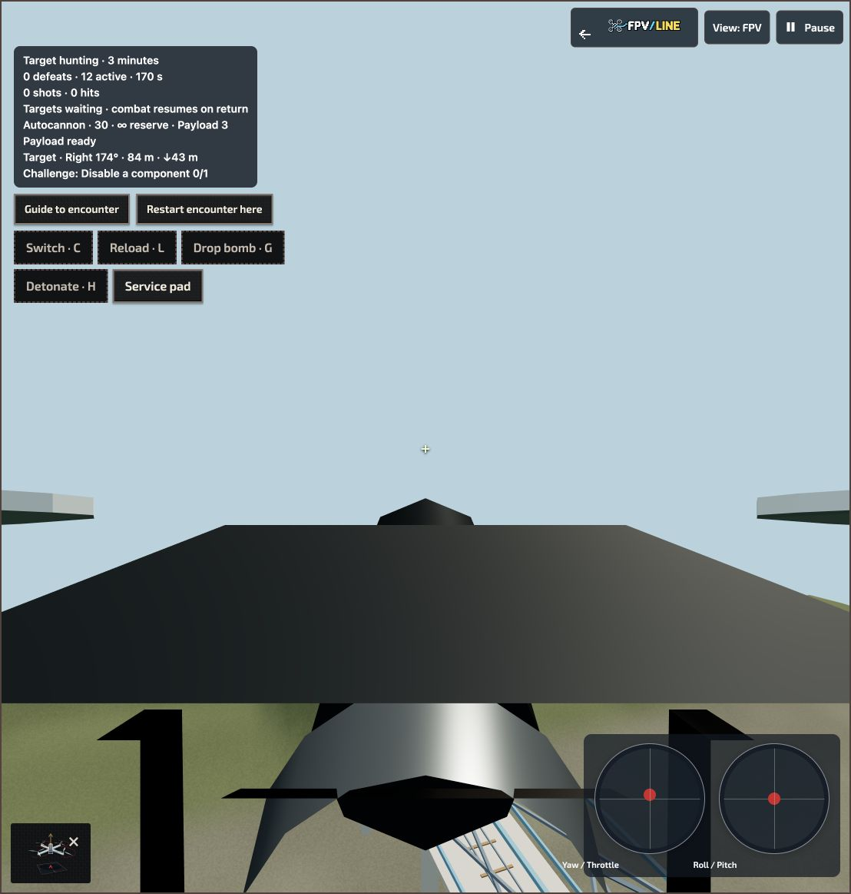
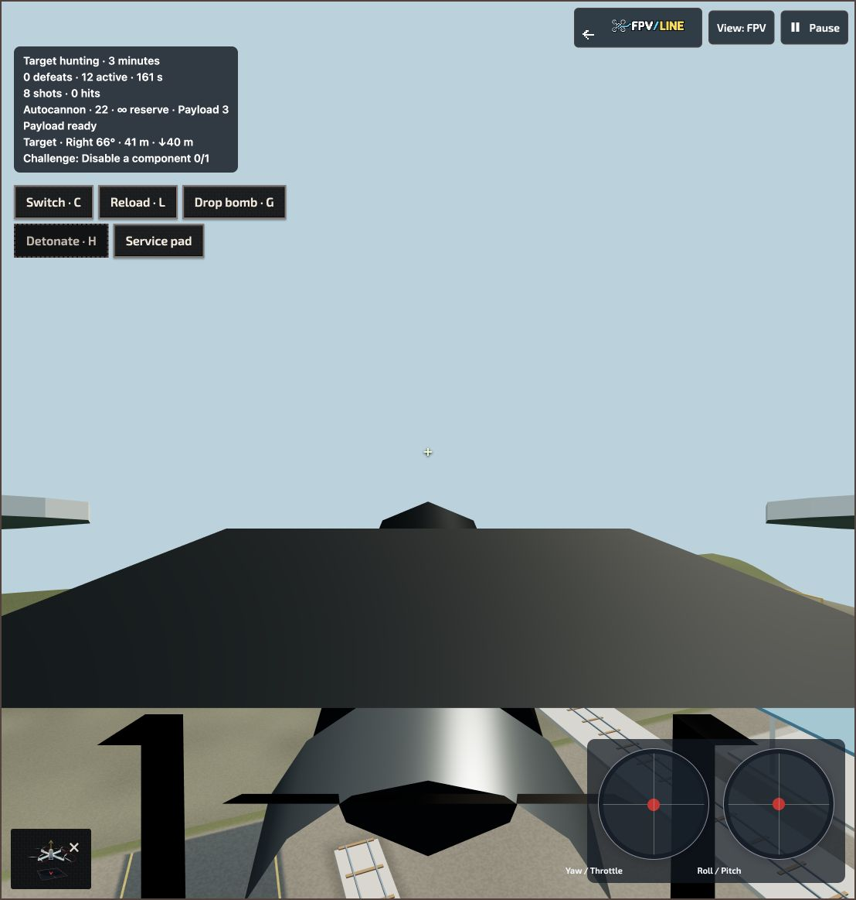

# Continuous flight across encounter boundaries — 20 October 2026

## Causes

The regional combat wrapper deliberately paused aircraft when leaving the encounter's X/Z bounds, blocked arming until the player chose Return, and paused again on reentry. This made a small target area act like a flight boundary.

A second deadlock could happen inside the encounter: the aircraft's predicted streaming window could omit part of the target area. Combat rejected the step for missing geometry before aircraft stepping ran, preventing the streaming work that could resolve the situation.

## Fix

- Flight automatically continues outside the encounter with its original actors held in place. Combat resumes on reentry without another arm command.
- Regional combat geometry holds use the same accepted flight-only path. Aircraft terrain admission still runs, so absent geometry is never treated as clear space.
- Targets, defeat totals, supplies, command queue and combat time stay unchanged during these intervals. Rejected physics intervals consume no time or commands.
- Existing phase-1 recording frames describe regional flight-only time. Replay honors that recorded intent even when geometry is ready sooner. Recorded combat frames wait for geometry rather than silently changing phase. Native and aftermath phase validation remains strict.
- Explicit pause, focus loss, actual map boundaries and worker errors retain their existing behavior.
- The HUD explains that targets are waiting or combat terrain is loading. Return guidance is automatic when there is no selected waypoint; Guide to encounter remains optional. Waiting combat does not leave a frozen hit marker, damage overlay or camera shake.

## Verification

- Full session, replay and adapter suites: **52/52 pass**.
- Focused historical regional recovery and streamed terrain-adoption checks: **2/2 pass**, with 37 unrelated tests excluded by the name filter.
- The mounted UI suite and final source fingerprints are recorded in [validation receipt](overhaul-seamless-boundary-validation.json).
- Actual native Standard/Advanced and regional Standard/Advanced adapters cover geometry admission, recovery and replay. Regional adapters keep flying through a combat-geometry hold; native behavior stays unchanged.
- Deterministic boundary tests cover synchronous/asynchronous exit and return, explicit pause, rejection and failure, queued commands, recovery and replay with different geometry readiness.
- Actual local Railway Valley browser flight crossed the former 40 m horizontal limit, remained active beyond it, returned without Resume or an arm toggle, and fired eight shots. The capture shows Pause available while the target is 84 m away. The hunting clock resumes after return.
- Keyboard/Self-level/Hunting were temporary verification settings; USB radio/Acro/Strike were restored afterward. No physical-radio flight was performed.
- Formatting, changed-source lint, whitespace and generated-runtime checks pass. All runtime/source package envelopes pass; see [package receipt](overhaul-seamless-boundary-packages.json).

The browser check also reached the map's real altitude ceiling during an earlier trial; that legitimate outer-map stop remains enforced. This fix removes encounter-induced stops and the identified combat-streaming deadlock, not the physical limits of a map. It is not a new all-catalogue or sustained-performance qualification.

Existing v2 recovery files remain readable. New inside-area flight-only intervals require this updated playback implementation; older builds interpreted phase 1 only as outside-area return flight. No proof hashing or geometry validation was weakened.

