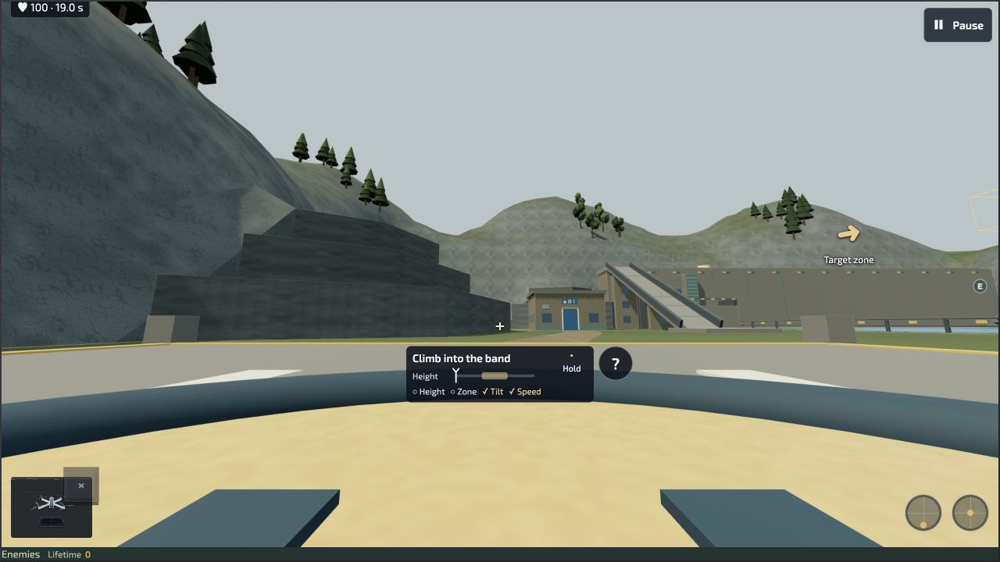
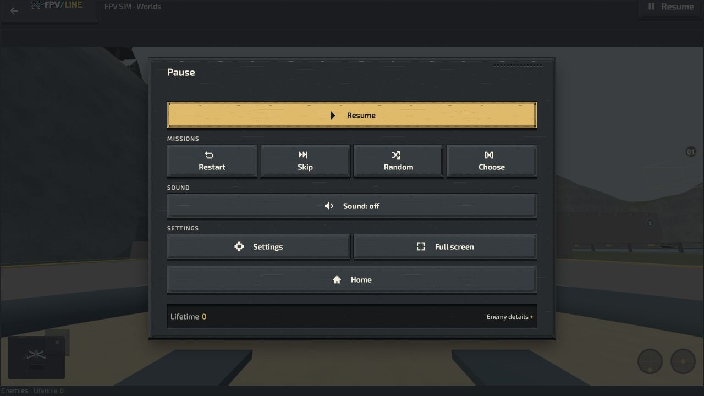

# Current-main bounded qualification — 13 October 2026

The existing candidate workflow passed on exact main `45e943bd40831e21fa9b55cb712725e49a901e13`: three optional packages with two reproducible builds and committed-input verification, plus the selected `fpv-learning` company edition. This is artifact admission; public release review remains pending. The original candidate review file is retained unchanged.

The World package has 122 admitted members. Its 117 source inputs match both that main revision and the actually tested public deployment `6514e5c3ab8171bc75af287e08262977db88e2b3`. The source bridge does not equate generated package identity with public identity.

## Public Creator

Reservoir course 02 was edited in Acro only: first hold X moved from −10 to −9.9 m. Native Undo/Redo, mode switching and course switching retained the correct values. Export used the real download control. Inspection through the native editable-ZIP parser found exactly four expected coordinates changed: the two Acro hold bounds and their canonical layout equivalents. All seven other courses, Self-level, spawn/route/source bindings and all GLB bytes remained identical. The public draft was restored to −10 m; the installed original was never overwritten.

The exported ZIP remains in the local Downloads folder; its exact size and hash are in `creator-export.json`. A native reimport was not performed.

## Exact admitted player

`scripts/stage-fpv-shell-admitted-player.mjs` validated 263 checks and extracted all 122 members without overlays. On a separate loopback origin, the real Library downloaded Reservoir r16. Settings → Content & Offline → Prepare simulator offline completed. The dedicated origin server was stopped, the same player entry reloaded, and the installed eight-course world reopened in Creator. Course 02 entered a test flight, remained unarmed until Arm / resume, and advanced from 0.2 to 19.0 seconds with neutral input. Pause hid the objective HUD. No captured warning/error logs were returned. The server was restarted afterward.

The global flight mode stayed Self-level; selecting Acro in the editor selects the edited route, not the global flight preference. Whole-device networking was not disabled. This proves bounded stopped-origin reopen and native flight, not every offline recovery or update scenario.

## Remaining

Complete the cohesive interrupted-install, native reimport, rollback and records/playlist journey; measure longer workloads and disposal; finish the representative quality gate before Canals; then D6. Physical-radio, novice and named-device FPS acceptance remain unclaimed. One observed usability follow-up: the offline preparation button is in Settings while its final status is currently displayed in Library.

## Storage recovery

Safe cleanup restored approximately 5 GiB of available headroom (fluctuating). Disposable download/compiled-code caches were cleared. More than ten thousand old generated build paths were byte-verified and retained as independent APFS copy-on-write copies, along with every unique file. No source, Git objects/refs, worktree, browser database, recording, unfinished change or unique evidence was deleted. Detailed local hashes and mappings are in `~/.codex/cleanup-receipts/`; no user filesystem inventory is published here.
