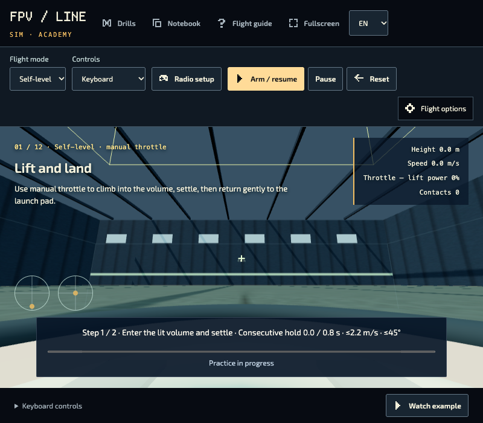

# Flight practice: player guide

[Українська](flight-practice-player.uk.md). The same task-based help is shipped as `guide.html` inside each package and linked from its launcher. It remains cached with the package.

## Choose and play

Open **Help & Extras → Flight practice**. Choose **Play** to open the app directly in a new tab, or **Details & guide** for requirements, support, offline preparation and help. There are no unlocks. Practice never grants campaign wins. The existing **FPV flight simulator** shortcut is unchanged.

There are no campaign prerequisites. A host may still require its site password before opening an app or guide; use the access provided by the site owner. Do not include that password in screenshots or support reports.

| App                 | Start here                                                                                                                                                                               |
| ------------------- | ---------------------------------------------------------------------------------------------------------------------------------------------------------------------------------------- |
| Civilian flight gym | Assisted movement/orientation. Use **Start** for the selected drill, or **Select Mission** to choose **Lift and return**. Keyboard, touch buttons or standard gamepad; a simple 2D view. |
| FPV Flight Studio   | Focused lessons. Choose **Lift and land**, open **Flight guide** for controls, then **Watch example**. Choose self-level or Acro. Requires WebGL2.                                       |
| FPV World Studio    | Worlds, playlists and creation. Choose **Watch first flight**, then **Try first flight**, or open **Flight School** for guided lessons. Requires WebGL2 and more memory.                 |

## Inputs and your first attempt

Use **Settings → Controls** and each app’s maintained Flight guide for exact bindings. Flight Studio’s guide is under **Settings → Help & Extras**. Open the app from its launcher or the guide’s **Open app** link. Do not import another simulator’s bindings as if they were already verified here.

- **Keyboard:** select Keyboard, focus the flight view and use the displayed controls.
- **Touch:** select Touch · Mode 2 in the FPV apps and use their visible sticks. Releasing a stick is not a pause command. Gym uses held touch buttons.
- **Controller / Steam Deck:** select this separate FPV input option, connect a supported standard controller, centre the sticks and release its buttons before arming. Gym has its own standard-gamepad selection. A standard gamepad does not need USB-radio calibration.
- **USB radio:** open **Settings → Controls → Radio setup**, complete its guided calibration and direction checks, then follow the arming prompt. Device/browser support varies; see the SIM-owned [radio setup guide](fpv-radio-guided-actions.md) for the maintained setup and backup workflow.

Start or arm explicitly and follow the on-screen target. Use the selected lesson’s flight mode: World Studio includes guided Acro lessons and optional self-level lessons. Self-level assists leveling; Acro does not automatically return to level. Both FPV modes use manual throttle and neither holds altitude or position. The SIM-owned [flight-response guide](fpv-shared-flight-guide.md) explains the live teaching display.

Use **Pause** before changing setup and **Reset / Retry** for a fresh FPV attempt. Gym’s pause menu offers **Resume** and **Restart**. Use **Back to lobby** to change World Studio flights. A demonstration is an example, not a completion you earned. Practice is not a claim of real-world piloting proficiency.

After focus loss or a disconnected device, return to the app and follow its resume prompt. A recovered session should not begin flying on its own.

In either FPV app, use **Settings → Accessibility → Flight guidance**. Choose **Guidance → Detailed** for numeric objective readings; **Text size** and **HUD contrast** are separate choices. These settings survive reload. They do not start a flight, hold altitude or stabilize the aircraft.

## Offline versus home-screen installation

1. Open **Details & guide → Download for offline use**, or the app’s existing Prepare offline action: **Settings → Content & Offline** in Gym and World Studio, or **Settings → Help & Extras → Flight guide → Workshop & offline** in Flight Studio.
2. Keep the tab open while **Downloading → Verifying** runs. Cancel stops that new attempt without removing a previous prepared version. An inactive download times out after 30 seconds; the overall maximum is five minutes.
3. Wait for **Ready offline** in the stable launcher. This checks the exact owning worker and cached dependencies, not just a saved pointer.
4. Bookmark the stable launcher address. Close all site tabs, disable networking, and reopen it in the same browser profile on your device. Open the prepared version.
5. Separately, choose **Add to home screen** if offered. Otherwise use the browser’s Install app menu, or iPhone/iPad **Share → Add to Home Screen**. Support varies. Online play requires neither installation nor offline download.

Open the new app icon once while online. Check or prepare its offline copy there, close it, disable networking and reopen it. Browser profiles and installed-app windows can have separate storage, so readiness in a browser tab is not proof for a different window/profile. An icon alone does not guarantee offline play. See [browser installation differences](https://web.dev/learn/pwa/installation).

## Updates, removal and backups

**Update available** does not reload a flight. Prepare the new version when ready; the previous prepared version stays linked. A waiting launcher update may require closing its tabs.

**Remove this offline copy (keep records)** removes only the selected version’s app-shell caches and worker. It does not delete flight records, controller calibration or imported worlds. Browser “clear site data” is broader and can delete all of those: export recordings/notebooks/playlists/worlds first with the app’s current export tools. There is no automatic backup guarantee.

Removing a home-screen icon or uninstalling a browser app is a separate operation. Read any option to delete site data before confirming. Keep exported backups outside this site’s browser storage; check that you can find and import the file before relying on it.

**Radio calibration and the tuning library are separate backups.** In the FPV apps, keep Radio setup’s **Export profiles** file for calibration. For rates, throttle and saved drone setups, open **Settings → Controls → Radio setup → Rates & throttle → Library → Import / export · Betaflight and backups**, choose **Backup complete library**, then **Download file**. Save the downloaded JSON outside browser storage. **Export SIM rates** and a rate-only CLI export are not complete-library backups. To restore, open the same section, use **Upload text / JSON** to load your library JSON, wait until its text appears, then choose **Restore library backup**. **Restore library backup replaces the saved library**: first back up any current settings you want to keep. Importing radio calibration does not restore the tuning library. Restored settings apply to a new flight, not an already running attempt.

Apps own separate caches but share this origin’s quota with other games on the same site. Browsers can evict cached files. If **Needs repair** appears, reconnect, remove only the affected offline copy and download again. For denied/full storage, allow storage or leave private browsing, free space and retry. World Studio’s **Request persistent storage** can reduce eviction risk if granted; it is not a backup or a guarantee against user-initiated deletion. See [browser storage and eviction](https://developer.mozilla.org/en-US/docs/Web/API/Storage_API/Storage_quotas_and_eviction_criteria).

**Browser eviction can remove records and imported worlds, not only cached files.** This differs from the launcher’s scoped removal. Keep exported backups outside browser storage. If records are missing after eviction, reconnect, prepare the app again, then restore your exported backups with its import tools. Downloading the app does not recover lost records; without an export, they may be unrecoverable.

## When something is missing

- **Download stalled / exceeded five minutes:** check your connection and retry online. Cancelled means that attempt stopped, not that a previous copy was removed. A combined download or verification failure does not identify a single cause: check connection and browser storage, then retry. Permission errors do not necessarily mean storage is full. Check saved copies in the launcher before relying on them offline.
- **Empty catalogue:** no reviewed packages have been selected for the host. Use the existing FPV shortcut and guide in the main game.
- **Request failed:** retry. A dated cached catalogue is not a fresh availability check.
- **Offline verification could not finish:** choose **Check available practice** again. This is not proof that files are missing; keep the saved copy while verification is incomplete. Previously verified actions can remain available. Use removal/re-download only when the launcher reports **Needs repair**, not just an unfinished check.
- **Unavailable version:** retry online or open a verified prepared version. A retired online version may no longer be hosted.
- **Blank 3D view:** check WebGL2/hardware acceleration or try Gym. Report browser/device, package version and error through **Support / report a problem**, without private recordings.

**`.rlpack` imports add content inside World Studio. They do not add executable apps to Flight practice.** Maintainers should follow the [package publishing guide](flight-practice-maintainer.md).
