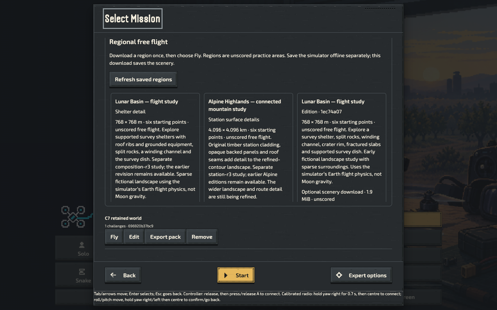

# Flight practice: repair and player-flow acceptance

Hosting remains deferred. This continuation follows the
[pointer correction](flight-practice-pointer-2026-10-15.md) with package recovery
checks and observation of the ordinary player controls.

## Source and integration

The branch rebased cleanly onto main `691351e1d757276eea7e94cc08fca07f6a16021f`.
That main includes SIM's new Lunar shelter Library offer. The earlier candidate
does not contain that offer; retain its exact source identity in every receipt.
Its package source is `bf31260eb82530eeca38e1c2d84f63a22696946e`, tree
`e86346d82dc81d8d0fee94f7ab189668cb743e56`, envelope SHA-256
`128b8447235424fcb18aa1cc99a49a6ebeccb23cc86d7a0704c85fd2793cbd4c`.
All three original package archives remain independently admitted development
artifacts. No release has been allocated or selected.

### Fresh candidate after the next main update

The subsequent clean rebase includes main `e51ff517e` and SIM's Alpine station
Library offer alongside Lunar. The fresh candidate is source
`50b7612e8d170e2ab377e5eda117898dafc857cf`, tree
`f3531120cf9add93ff7953eaabf4822f70593f86`, at
`/Volumes/alex/CodexMigrationStaging/flight-practice-repair-current-20261015.L1l4Uv/candidate`.
Its [original envelope](flight-practice-repair-20261015/current-optional-packages.json)
has SHA-256 `60a579e6ec9e309841c875014c15143dea49892c2fe5546417e1bf66f3b3a09e`.
The [build receipt](flight-practice-repair-20261015/current-candidate-verification.json)
confirms two byte-reproducible builds, committed inputs and ZIP-member admission
for all three packages, retaining `publicEligible: false` and development
`v0.151.1`. File counts remain 94/101/162, within unchanged package policies.

Direct old/new distribution-member comparison found changes only to generated
`optional-package.json` and `worker.js` in Gym/Academy; Worlds also changes
`civilian-fpv/regional-library.mjs`. Generated bindings are new identities, not
evidence that the older receipt tested the later package.

Before submitting review, recovery PR #1487 merged. A final clean rebase onto
main `a201b3789` removed the already-applied prerequisite commits. The
[input comparison](flight-practice-repair-20261015/final-rebase-input-check.json)
verified every original candidate input against this rebased checkout:
87 Gym, 94 Academy and 155 Worlds input files, **zero changed hashes**.
No optional-package input changed in that main update. Original package and
observer receipt identities above remain unchanged; this comparison is not a
new artifact build or a relabelled browser run.
Post-rebase tooling checks passed 34 observer and 19 installation-observer tests;
scoped lint and whitespace checks passed again.

## Verification exchange diagnostics

The earlier [failed installation run](flight-practice-pointer-20261015/installation-unverified.json)
prepared all three apps, then Academy's active runtime verification was
inconclusive after every window closed. Open stayed hidden. Missing files would
normally produce the separate confirmed repair state. The receipt cannot
distinguish a timeout from a registration/message error or a worker-reported
inspection exception. The [unchanged retry](flight-practice-pointer-20261015/installation-retry.json)
passed all nine checkpoints; that does not establish the cause of the failure.

The observer now offers opt-in registration/status-message/page-lifecycle tracing
and first-page CDP worker events. It forwards native calls, promises, transferred
ports and replies without changing the admitted package files. It never starts a
message port, changes a password form, forces worker activation or retries a
failed verification automatically. The per-document and aggregate event limits
are bounded; output contains only selected public status metadata.

```sh
OPTIONAL_INSTALLATION_DIAGNOSTICS=1 \
OPTIONAL_INSTALLATION_COLD_RELAUNCHES=5 \
node scripts/observe-optional-installation.mjs \
  PLAYWRIGHT_MODULE EXACT_CANDIDATE NEW_REPORT_JSON
```

Supply authorized access through a protected environment or silent input. Keep
credentials out of command arguments, plans and evidence. Repetitions accept
integers 1–5; the original ten-minute observation and 30-second status limits
remain unchanged. This instrumentation can affect scheduling, so retain its
results as diagnostic evidence. CDP worker events come from the first page's
session, which detaches when that page closes. Protocol bindings continue across
new pages. The protocol event definitions are documented in the
[Chrome ServiceWorker domain](https://chromedevtools.github.io/devtools-protocol/tot/ServiceWorker/).

| Receipt                                                                        | Observed result                                                                                                                                                                                                                                                                    |
| ------------------------------------------------------------------------------ | ---------------------------------------------------------------------------------------------------------------------------------------------------------------------------------------------------------------------------------------------------------------------------------- |
| [Initial diagnostic](flight-practice-repair-20261015/cold-diagnostic.json)     | Nine checkpoints passed; 398 events, 48 status requests, 42 replies observed; no explicit unknown reply. Slowest observed reply about 10.8 seconds.                                                                                                                                |
| [Five-round diagnostic](flight-practice-repair-20261015/cold-five-rounds.json) | All three apps reopened in each of five closed-window rounds, followed by installed-window and browser-process restart checks; nine checkpoints passed. 500 events, 71 status requests, 65 replies observed; no explicit unknown reply. Slowest observed reply about 2.83 seconds. |

Neither run dropped aggregate events. Some requests outlived their page's
navigation and therefore have no reply in that document's trace; that alone is
not evidence of a 30-second timeout. The deliberate damaged-package fixture
produced worker-install errors as expected. The five immediate reopen rounds do
not prove that the browser stopped every worker between rounds; the later
browser-process restart is a separate recorded transition. Both runs cleaned
their owned apps, browser/profile and server.

The intermittent failure remains unresolved. These observations justify better
future diagnosis, not a speculative runtime fix or a claim of universal cold
startup reliability.

## C7: cache/worker repair and isolation

The [native browser report](flight-practice-repair-20261015/cache-repair.json)
passed **16 checkpoints** in Chrome 155.0.8059.80 at 1440 × 900, DPR 1. Each of the
three apps was prepared through its ordinary controls. The observer separately
deleted exactly one hash-verified cached `index.html`, and unregistered exactly
the owning runtime worker while leaving its cached files intact.

All six faults produced **Needs repair**, withheld prepared/offline Open, and
kept the public Remove/Download actions available. Public repair restored the
complete exact cache six times. Removing each app's runtime copy preserved both
siblings' cache contents, worker identities and installation pointers. The
original artifacts, staged files and observer sources remained unchanged. All
cleanup operations passed; there were no page errors.

This is controlled fault injection in a disposable profile. It does not prove
actual browser eviction or device quota exhaustion. All observed database stores
were empty, saved-place storage absent and the profile record absent. These
fingerprints establish isolation of those observed states, **not preservation of
populated worlds or progress**. Gym records and unrelated localStorage keys were
outside the observer's allowlist. A populated World case remains required.

### Populated World repair follow-up

The separate [v2 report](flight-practice-repair-20261015/cache-repair-seeded.json)
passes **18 checkpoints** on the same exact `bf31260eb` packages. Through the
ordinary Workshop controls it cloned the “First three” template, named it
“C7 retained world”, and installed it. The actual World Studio database then
contained one project, one revision and one metadata record. Their full
fingerprints stayed unchanged through all six faults, six repairs and three
scoped removals. A final page reload showed the same installed card ID/title.
All source/artifact checks and cleanup passed, with no page errors.

This closes the earlier empty-project-store limitation for **that one authored
template copy**. It does not qualify imported model assets, regional content,
flight records, profiles, `.rlpack` import/export, process restart or native
browser eviction. The [complete original output archive](flight-practice-repair-20261015/cache-repair-seeded-originals.tar.gz)
retains the plan, 18 checkpoints, eight screenshots and source witnesses.
Those first two Library screenshots show the top of the scroll container, not
the saved card below the fold; retention there is supported by the original DOM
and database fingerprints, not visual card evidence.

The fresh candidate's separate [18-checkpoint run](flight-practice-repair-20261015/current-cache-repair.json)
also passed, with unchanged nonempty project/revision/metadata fingerprints,
six exact repairs, three scoped removals and clean shutdown. The observer now
scrolls the unique saved card into view before both screenshots. The same card
is visible after the final reload:



```sh
node scripts/observe-practice-cache-repair.mjs \
  EXACT_PLAN_JSON PLAYWRIGHT_MODULE NEW_OUTPUT_DIRECTORY
```

The plan pins the envelope, source commit/tree and all three package revisions.
Use the original retained plan as a shape example and replace every pin when
testing another admitted candidate. Never substitute a newer source name in an
older receipt. [Original outputs and hashes](flight-practice-repair-20261015/README.md)
include every checkpoint, the six screenshots and observer-source snapshots.

## Automated verification and remaining gates

The current practice suite passed **346 tests**, zero failures/skips; its
[original log](flight-practice-repair-20261015/practice-tests.log) includes the
quota integration regression. The new `practice:observer:test` suite passed
31 tests and is now required in candidate CI. The installation-observer suite
passed 14 tests; independent review repeated all 45 checks. The C7 v2 observer
has 10 focused tests. These are test-tool checks, not browser acceptance.
After the positive-quota correction, separate final logs record
[346 practice tests](flight-practice-repair-20261015/final-practice-tests.log),
[34 observer tests](flight-practice-repair-20261015/final-observer-tests.log) and
[10 pointer-tool tests](flight-practice-repair-20261015/final-pointer-tests.log),
all passing without skips. A separate regional-storage suite passed six checks
using the already available authoring dependencies; its initial missing-module
setup failure is retained alongside the successful unchanged retry.
The earlier pointer continuation retains its 345-test practice result,
10 pointer-tool tests, native UI regressions and all failed attempts. Later
source changes require their own appropriate checks.

### Player-flow attempts retained

The [first attempt](flight-practice-repair-20261015/first-flight-attempt1.json)
failed all four declared cases because of test assumptions about Pause,
Settings Back and the tutorial Retry control. The [second attempt](flight-practice-repair-20261015/first-flight-attempt2.json)
passed Gym and Worlds movement/pause/retry, but both Academy cases stopped with
Settings open: a background Home button was layout-visible behind the modal.
The observer now checks the actual open-dialog state before selecting Start.
Both failed aggregate results and original screenshots are preserved. Neither
attempt establishes exercise completion or an Academy runtime defect.

The corrected [third attempt](flight-practice-repair-20261015/first-flight-attempt3.json)
passed all four declared EN cases: Gym, Academy Self-level, Academy Acro and
Worlds Self-level. Each deliberately started, gained at least 0.2 m on the visible
HUD, held a paused state for 600 ms, retried to its initial height/zero FPV speed,
then moved and paused again. Cleanup and source checks passed. Controls used
ordinary keyboard actions plus pointer Pause/viewport activation; no force click,
runtime hook, imported proof or storage injection supplied motion. The receipt's
`qualified: false` remains intentional: this is not full C2, a completed exercise,
the main-game directory route, UK, Worlds Acro, human learning or physical input.

The [fresh-candidate first-flight run](flight-practice-repair-20261015/current-first-flight.json)
independently passed the same four declared cases and cleanup against the
`50b7612e8` envelope. Its complete output archive retains original per-case
results, screenshots and authority hashes. It has the same explicit limits.

An [independent audit](flight-practice-repair-20261015/independent-audit.json)
recomputed those case witnesses, C7's complete matrix and the Academy quota
retention comparisons. Seven first-flight authority files match committed
source. Its helper had the reviewed fail-fast check before a later comment-only
edit; this transient file was not snapshotted by the old observer. The
[post-run reconstruction](flight-practice-repair-20261015/first-flight-helper-reconstructed.mjs)
reverses only those two comment lines and exactly matches the original receipt's
9,319-byte length and SHA-256 `b1e47bf44eced82128ae7eb51a374aebe944d41b97756fa2c05dfd0f21560bd8`.
It is a reconstructed hash-matching source, **not an original capture**. Future
first-flight runs now automatically retain all eight authority source files;
nine regressions pass, including admission failure preserving exact snapshots.

### Controlled quota-denial protocol

`OPTIONAL_INSTALLATION_QUOTA_PROBE=1` adds an opt-in Academy preparation failure
using Chromium's `Storage.overrideQuotaForOrigin` on the disposable loopback
origin. V2 verifies a positive allowance of measured usage plus 1,024 bytes,
and checks all three saved installation pointers,
checks failed-scope cleanup, and restores the default quota without clearing
origin data. Only after the existing ordinary rollback does it try the pristine
alternate path again, preserving the single retained-version slot. Uncertain
reset or pending work prevents a passing result.

The [original zero-quota attempt](flight-practice-repair-20261015/quota-zero-attempt.json)
is a **failed control**, not denial acceptance. All three apps prepared and
reopened offline after browser-process restart; the new path then reached Ready
despite CDP reporting a zero override. Usage grew from 36,048,792 to 42,939,009
bytes. The callback timed out, its cleanup was conservatively unverified, and
the owning browser/profile cleanup succeeded. No app defect or preserved-pointer
denial result is inferred from that attempt.

The matching [Chromium 155.0.8059.80 source](https://raw.githubusercontent.com/chromium/chromium/155.0.8059.80/storage/browser/quota/quota_manager_impl.cc)
treats zero quota as unlimited in its remaining-space calculation. That explains
why a reported zero override was not a suitable write-denial control here. V2
uses small **positive headroom** instead, checks safe integer bounds, and rejects
unexpected Ready promptly rather than waiting for a false stall. Its 11 unit
tests pass; native v2 acceptance is tracked separately below, not inferred.

The separate [positive-headroom Academy run](flight-practice-repair-20261015/quota-positive-academy.json)
**passed all 13 checkpoints**. It measured 36,048,792 bytes used, verified a
36,049,816-byte limit, and received the ordinary actionable download/verification
failure. All three saved pointers stayed identical; no failed-path cache or
worker remained. Reset returned usage unchanged and `overrideActive: false`.
The normal pristine-path retry prepared successfully; its ordinary removal
restored the exact prior pointers. Imported synthetic proof/profile exports
remained byte-identical, and all three installed apps had reopened offline after
closing every window and restarting the browser process. Every quota operation
settled, all cleanup passed and no page error was recorded. The observer/helper
sources are committed at `499e75166`; the package source remains `50b7612e8`.

This is Academy's controlled origin-quota scenario, not every app's denied-write
path. The error text does not identify the failing cache API, so
`exactCacheWriteExceptionProven: false` remains correct. The imported flight
proof/profile are synthetic retention witnesses, not human flight or radio
calibration. Alternate version paths reuse one payload and do not close C5.

### All-three controlled denial, retry and removal

Set both `OPTIONAL_INSTALLATION_QUOTA_PROBE=1` and
`OPTIONAL_INSTALLATION_QUOTA_PACKAGES=all` for the opt-in complete app selection.
Omitting the latter preserves the original Academy-only route and report alias.
Each app now receives its own sequential measured positive allowance, terminal
failure check, exact all-pointer comparison and confirmed quota reset. Retry and
ordinary removal occur only after the original rollback frees the retained slot.
Gym then has no previous copy, Academy has the prior path, and Worlds has its
current copy; the observer checks those different histories rather than forcing
the same expected state on all three.

The [first all-three attempt](flight-practice-repair-20261015/quota-all-attempt1.json)
**failed overall after 20 checkpoints**. All three denials/resets passed and
Academy/Gym retries were removed; Worlds' retry was prepared, but the test tried
its removal button while it was hidden in Library. Settings contains its
preparation button, not removal. No removal action or data-loss conclusion is
inferred from that timeout. The test now follows Content → World library, waits
for the visible removal button, and every shared offline action requires a visible
control before sending a key. This corrects the observer, not simulator behavior.

The corrected [second all-three attempt](flight-practice-repair-20261015/quota-all-attempt2.json)
**passed all 21 checkpoints** on the unchanged `50b7612e8` candidate. All three
per-package quota results completed and reset; each pristine retry prepared and
was removed through its public controls, restoring the exact baseline pointers.
No failed-scope worker/cache remained after denial. Synthetic proof/profile exports
were compared after each denial reset, Academy's retry and the final offline FPV
reopen, not after every sibling's retry. Cache comparisons in this observer are
cache-name/worker-scope lists, not entry-byte hashes; C7 supplies the latter. All three
installed windows and browser-process offline restart passed, as did all cleanup;
no page errors or pending quota operations were recorded. The observer source is
`ff31c94f0`; the quota helper retains its v2 hash and semantics. This closes the
**controlled origin-quota preparation subcase for all three apps**, not actual
disk exhaustion/eviction, every record type, cancellation/stall or C5 migration.
The [separate all-three audit](flight-practice-repair-20261015/all-quota-independent-audit.json)
independently verified the package/tool bindings and all 21 checkpoint comparisons.

After the last navigation/visibility regressions, final verification passed
[351 practice tests](flight-practice-repair-20261015/verified-practice-tests.log),
[34 observer tests](flight-practice-repair-20261015/verified-observer-tests.log) and
[10 pointer tests](flight-practice-repair-20261015/verified-pointer-tests.log),
zero failures/skips. Scoped lint, formatting and whitespace checks passed.

This is a controlled **origin-wide quota override**, not actual disk exhaustion,
browser eviction or proof of a particular `Cache.put` exception. Registration
may fail before asset caching. The API and reset semantics are defined by
[Chrome's Storage protocol](https://chromedevtools.github.io/devtools-protocol/tot/Storage/#method-overrideQuotaForOrigin).

Remaining priorities are the intermittent verification failure; populated content
offline restart; the full directory/flight/exercise route in both locales; distinct
version migration with a protected active flight; cancellation/stall/write-denial
cases; and device, accessibility, performance, learning and content reviews.
The existing candidate archives all use `v0.151.1`; their different commits are
not evidence of a distinct-version release migration. Hosting and public release
selection remain deferred. See the
[executable checklist](flight-practice-release-checklist-2026-10-15.md).

Recommended next order, with no review waiver:

1. Finish C2's actual beginner exercise and EN/UK directory-to-app route, including
   Worlds Acro; the four-case motion smoke does not show the task is learnable.
2. Finish C6 cancellation, inactivity/overall limits and per-app denied recovery;
   then C4's populated-content browser restart. These protect downloads and saved
   work. Keep the intermittent inconclusive check unresolved until reproduced.
3. C5 needs genuinely different versioned packages and active-session update
   protection. Renamed identical paths cannot detect migration compatibility bugs.
4. Complete Gym/Worlds pointer and focus recovery, agreed moving-flight performance
   budgets, promised physical inputs/accessibility and novice/maintainer sessions.
   Automated DOM checks cannot supply those human/device decisions.
5. Collect the actual eight review decisions per app (24 pending decisions).
   Build admission is not content, licensing or release sign-off. Hosting remains
   deferred; nothing in these results populates the public catalogue.
