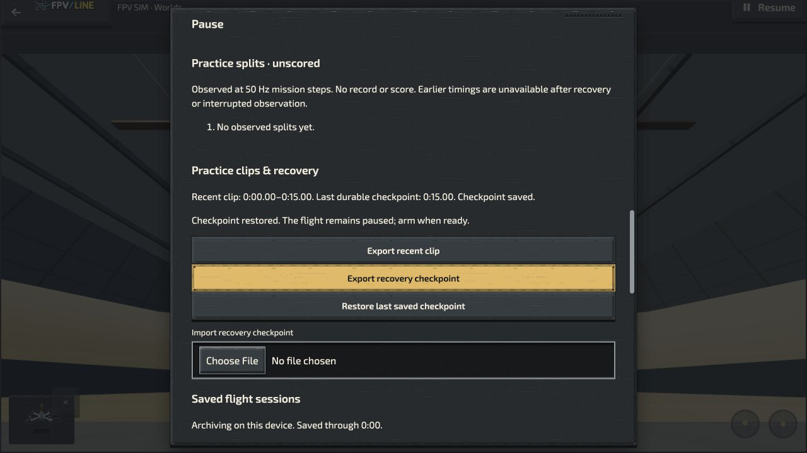
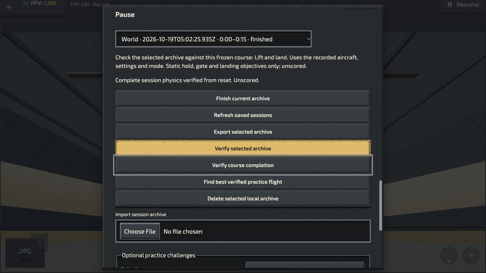

# Offline flight, recovery and update acceptance

Observed 19 October 2026 in the desktop in-app browser, through ordinary UI and
keyboard input. This is an owned local origin, `http://127.0.0.1:9242`, not the
public installation. No hidden browser storage inspection or deletion occurred.

## Sources and procedure

- Baseline World package: `1dfb180f2c699692afe2fc121a845f5e5f7ef727`.
- Successor World package: `9dd87a9c1aeb05107b4d13f0e5f6806f75f38faf`, tree
  `3f99693d2821d8c50d42e360a77e6e6bea531d63`.
- Each package was built from its committed extraction. A local static server
  served the baseline, then the successor at the same origin. This exercises
  the mutable-launcher service-worker update path.
- Normal **Prepare simulator offline** completed on the baseline. A saved setup
  named **Meteor75 offline check** selected the 2022 analog Meteor75 and its SIM
  starter rates, with no pending draft changes.
- The server process was stopped. Reload still opened the simulator. **Fly now**
  opened the World-host **Lift and land** lesson in Self-level mode.
- Actual keyboard throttle input produced lift: at approximately 62% throttle,
  the UI reported 0.3 m height and +1.5 m/s vertical speed, upright with zero
  reported drift. The flight paused normally. This was a short lift/recovery
  check, not successful completion of the lesson.
- **Finish current archive** saved
  `World · 2026-10-19T05:02:25.935Z · 0:00–0:15 · finished`.
  **Verify selected archive** reported **Complete session physics verified from
  reset. Unscored.** with the server still stopped.
- **Restore last saved checkpoint** restored 15.00 seconds and explicitly kept
  the flight paused. The visible durable checkpoint was 15.00 seconds.
- The successor server was started at the same origin. A normal reload allowed
  the browser to download the update. The owned tab was closed and reopened,
  allowing waiting-worker activation naturally; no hidden worker commands were
  used. The server request log records the successor dependency download.
- The workbench retained **Meteor75 offline check**, its assigned SIM starter
  rates, and **0 changes · Saved for next flight**. Offline preparation reported
  completion immediately.
- The successor server was stopped. Reload again succeeded. The new **Find best
  verified practice flight** control was visible while the server was stopped,
  confirming that the updated UI was available offline rather than only the
  former cached UI. The pre-update archive remained selectable and its physics
  replay again verified completely from reset through the native worker.
- Warning/error console observations were empty. Owned tabs and servers were
  closed after the check. All local archives and settings were retained.

The successor server log does retain one `404` for the optional
`/game/ui/global-settings-tools.mjs` import when Settings opened. This was the
application's ordinary request, not an independent probe. The source's
`mountSimGlobalTools` catches an unavailable main-game provider and retains SIM
tools with localized fallback feedback; the standalone package does not include
that provider. An empty warning/error console observation is therefore not a
claim that every network request succeeded. The SIM offline preparation and
native archive verification results above were observed independently.

## Evidence and limits

The accompanying `.txt` files are accessibility observations; the update text is
an incremental observation, while its screenshot shows the complete result.
Local request logs are retained as
`.cache/offline-upgrade-9242-{baseline,successor}-server.log`.

This closes a specific World-package server-loss, checkpoint recovery and normal
update compatibility check. It does not establish OS-wide network disconnection,
standalone installed-app behavior, storage eviction, interrupted-update recovery,
native-wrapper behavior, all browsers/devices, final Pages deployment, or
whole-aircraft physical fidelity. It changes no simulation constants or scores.
