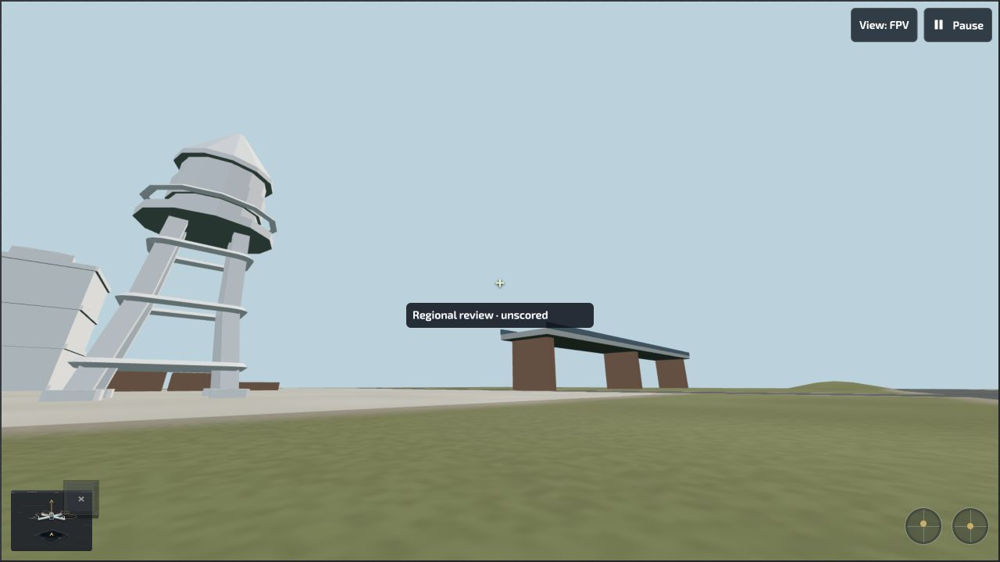
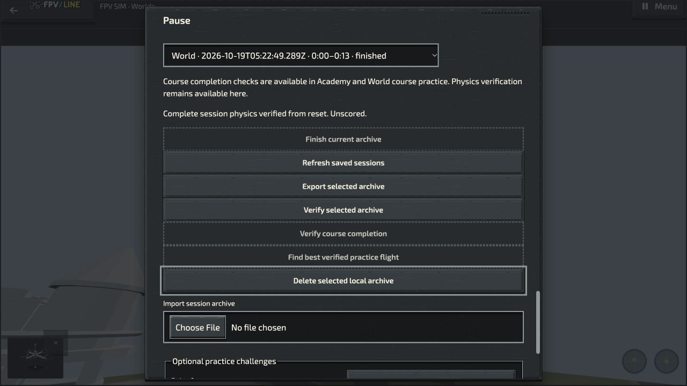

# Rendered Regional flight acceptance

19 October 2026, owned local World package at
`http://127.0.0.1:9243/optional-practice/fpv-worlds/index.html`.
Source `ecfb4bc01dc3f6d4e7d56062be89725d26d0a491`, tree
`481bd57f1b0d549c4f9f728660673dd0751bd974`; World artifact revision
`95678271e5d96a5df800d8c3b9201dcbb7974bb9eb8ee701ca53f6e89362fe4f`.
All 243 packaged source inputs match the qualified latest-main runtime at
`7109710578`. This is the actual game UI, separate from the small worker harness.

## Observed procedure and results

1. In normal Settings → workbench, select the 2022 analog Meteor75 with aircraft
   starter rates, use it in the draft and save **Meteor75 Regional check**.
   The saved setup reports zero changes. No PID values or physical coefficients
   were edited for this check.
2. Through Explore worlds, download **Urban earthworks — regional preview**,
   revision **review-r2**, about 2.2 MiB. The UI reports saved for offline flight.
   Choose Fly. The simulator shows **Loading area** with Arm disabled, then
   **Ready to arm**, still paused at zero throttle.
3. At **1 · Mill court**, explicitly arm and use real keyboard throttle input.
   The aircraft initially descends from its authored five-metre starting height
   while throttle rises; it subsequently lifts from the ground. After pause and
   resume, the UI reports **65% throttle, 0.9 m, +2.8 m/s vertical and 0.0 m/s
   drift**. These are visible observations, not a tracking/performance benchmark.
4. Open the paused workbench: its header reads **Meteor75 Regional check ·
   BETAFPV Meteor75 · SIM starter rates · 0 changes · Used by this flight**.
   Close without editing. At 10.00 seconds, a durable checkpoint is reported.
   **Restore last saved checkpoint** succeeds with **The flight remains paused;
   arm when ready**.
5. Select **2 · Tower court** and **Restart here**. Terrain loading again disables
   Arm; readiness leaves the new attempt paused at zero throttle. Explicitly arm.
   After raising throttle and a short pitch input, visible flight reports
   **60% throttle, 1.1 m, +2.8 m/s vertical, 1.2 m/s drift** with the stick centred
   again. Pause normally.
6. Finish the 13.14-second Tower court archive. The normal archive selector shows
   `World · 2026-10-19T05:22:49.289Z · 0:00–0:13 · finished`. The generic host label
   is World; this is the Regional free-flight attempt described above.
   **Verify selected archive** completes through the native worker with
   **Complete session physics verified from reset. Unscored.**
7. Warning/error console observations were empty. The owned tab was closed while
   paused, and the local server stopped after testing. Settings, downloaded
   region and local recordings were retained; nothing was deleted.

Full accessibility observations for the active setup, flight telemetry, recovery,
second-area readiness and archive result accompany the screenshots in the same
evidence directory. The [artifact receipt](verification/fpv-regional-worker-20261019/world-artifact-ecfb4bc01d.json)
identifies the source-bound package. The complete local HTTP log records 372
requests: 176 returned 200, 194 returned 304, and two returned 404. Those were
`/favicon.ico` and the optional main-game `/game/ui/global-settings-tools.mjs`
provider, once each. The latter follows the standalone package's caught Settings
fallback. An empty console observation is not an all-request assertion.

## Remaining scope

This closes representative rendered Regional download, two launch-area terrain
admissions, saved-setup selection, keyboard lift/control, pause/resume, checkpoint
recovery and complete short-recording physics verification on one available
desktop browser. It does not establish continuous flight across region-cell
boundaries, every map/aircraft/mode, long-duration storage, installed/offline
Regional behavior, physical radio/touch support, a 2× performance gate, final
Pages acceptance or measured real-aircraft fidelity. The independent native
worker fixture covers synthetic transactional frame changes, not those wider
rendered cases. Both forms of evidence retain their precise scope.
