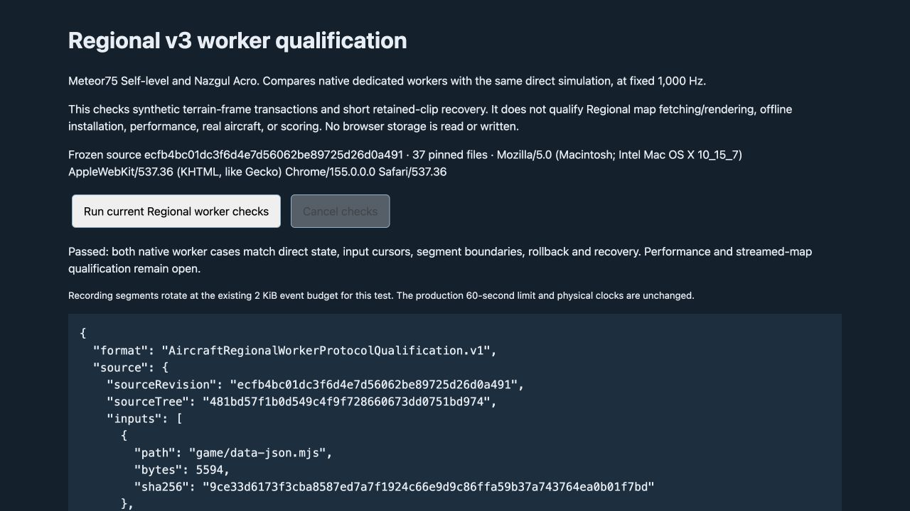

# Current Regional v3 dedicated-worker protocol fixture

This source-only fixture fills a narrow qualification gap: the older Regional worker helper targets the historical Advanced model, while the current v3 browser matrix uses the reference floor without replacing terrain frames. It adds no application import, package entry, physics change, scoring eligibility, performance remedy or automatic promotion.

The two fixed cases are BETAFPV Meteor75 / Self-level and iFlight Nazgul ECO XL5 V1.1 / Acro, using their current saved-data descriptors at `civilian-quad-aircraft-regional.v3`, 1,000 Hz physics and 50 Hz mission boundaries. The deterministic schedule has 96 missions (1.92 simulated seconds), three small authored collision frames, and ordinary input samples. It checks:

- Direct simulation versus the existing default native module-worker client, including final physical/controller state, hashes, consumed input clocks and accepted segment boundaries.
- Added/removed terrain colliders, rejected frame adoption and identical-frame no-op behavior.
- A rejected mission at an observed recording-segment boundary, with the queued sample retained and consumed once. Complete snapshots must remain equal across both rejection paths, including controller/motor/input/recording state.
- Pause without advancing, checkpoint continuation in a newly initialized worker, complete continuation checkpoint/recording equality, reset, and retained-clip replay.
- One awaited client request, at most one queued input in every observed checkpoint (including the queued rollback sample), two sequential owners, and at most three retained recording segments within a 2 MiB budget.

The fixture selects the existing recorder's **2 KiB event-byte rotation**. It does not change the production 60-second rotation threshold, accelerate physical time or claim a 60-second flight. The returned replay scope is `checkpoint-clip`; it is not a complete-session archive or scored course proof. Retained-clip replay runs on the caller thread (the page for a browser run), including when verifying a worker-produced recording. Fresh-worker restore uses the native worker protocol; this does not test a separate native `verify-recording` request. Synthetic frame adoption does not exercise regional cell fetching, map-source validation, graphics admission or the complete rendered Regional host.

## Native browser procedure

From the clean committed isolated checkout, start the source-only server:

```sh
node scripts/serve-fpv-regional-worker-qualification.mjs 9241
```

Open the printed local URL through the normal browser UI. Select **Run current Regional worker checks**. The visible status identifies the aircraft, direct/worker phase and mission count. The result contains source revision/tree, file hashes, user agent and separate baseline/native-worker outcomes. Select **Cancel checks** during a run, confirm the cancelled state, then run again. Closing the page cancels and terminates its owned worker. No browser storage or archive store is read or written.

The server binds only `127.0.0.1`. It requires clean committed source, validates every captured original byte against that commit, follows literal module/lazy-import/worker URL dependencies, rejects dynamic or external dependencies (recognizing the existing, shape-checked worker-identity URL comparison as inert), and serves only the captured allowlist. Later disk edits cannot change served bytes. The page, server and source-check helper are included in the provenance inventory. This pins application bytes under the local tool/runtime trust boundary; it does not attest the browser, installed Node packages or a hostile JavaScript environment. No public host, service worker, installation or package cache is used. Stop the server after testing.

## Software checks and evidence boundaries

```sh
node --test game/test/fpv-aircraft-regional-worker-qualification.test.mjs scripts/test-fpv-regional-worker-server.mjs
```

Node tests use a structured-clone adapter around the production worker handler; they are **not** native browser-worker evidence. They compare both complete fixture outcomes with direct execution and cover cancellation before startup, during a request and while paused, late replies, resource disposal, retry after failure, incorrect timing and changed rollback state. Dependency tests cover imported/re-exported/lazy/worker dependencies and rejected external, escaping or dynamic paths.

Native browser acceptance is recorded below. A pass closes this bounded worker-protocol check only. Firefox's retained 0.890× landing and 1.461× worker performance failures are not replaced by this short fixture. Streamed Regional host transitions, installed/offline/update behavior, other devices, sustained storage, measured aircraft fidelity and scored/default promotion remain separate gates. Every report explicitly leaves performance qualification, scoring and default eligibility false.

## Native UI acceptance — 19 October 2026

The normal in-app browser UI ran frozen source `80bf50f7fffcf3a5d4f87d299c9d65a1c8f59572`. Both cases passed, a subsequent run was cancelled through the visible control, and a fresh run passed again. The first attempted Cancel arrived after its run had completed and did not count as cancellation evidence; a later prompt Cancel visibly reported cancelled.

The final integrated source `ecfb4bc01dc3f6d4e7d56062be89725d26d0a491` was then captured separately, with all **37 files / 6,143,522 bytes** checked against its commit. Only the translation catalog differed from the earlier capture. On that exact source, visible cancellation followed by a fresh run again passed both native cases. Warning/error console observations were empty. The source-pinned visible JSON reports and screenshots are retained under `verification/fpv-regional-worker-20261019/`.

Meteor75 Self-level finished at hash `8f2a72b1`; Nazgul Acro at `f9561dce`. Both matched their direct baseline, including full controller/physical state, accepted and consumed input sequence 95, consumed timestamp 1,900,000 µs, and fresh-worker recovered hash. Each observed recording boundaries at mission ticks 41 and 78, rolled back the rejected mission at tick 41, retained at most three segments, and observed at most one queued input. All terrain rollback, mission rollback, identical-frame, pause, reset, recovery and caller-thread retained-clip checks passed.

These are **96 accepted mission steps / 1,920 physics steps / 1.92 simulated seconds** per case, with the unchanged small event-byte rotation rule described above. They are not 60-second recordings, complete rendered map flights, timing benchmarks or real-aircraft evidence. No browser storage was read, written or deleted by the harness. Owned tabs and servers were closed after testing.


