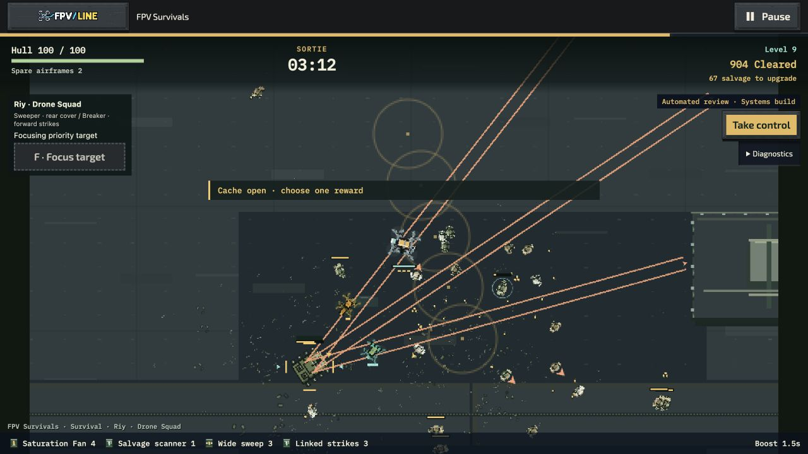

# Attack-path readability — 15 October 2026

## Integration

Safely rebased the clean previous follow-up onto fetched main `859d5cfc9`; 389 main commits were incorporated without rewriting any remote history. PR #1344 is merged. New runtime commit: `f494367b7` on `codex/overflight-build-readability`.

The Overflight runtime on this main checkpoint is byte-identical to the preceding quality follow-up before these edits. Its six fixed-build results remain attributable to their original commits; they are not rerun results. The earlier Echo and Riy priority-build losses still require gameplay investigation.

## Delivered

- **Echo/Fan preparation:** render every queued impact footprint at its actual released position and heading. Echo shows its successive rear positions; Fan shows the lateral charges. Cues disappear with each real impact and freeze on pause. These are light, nominal friendly footprints—not hit guarantees through cover—and remain beneath hostile warnings and the player.
- **Riy Linked Strikes:** preserve up to three accepted link segments at impact time, including legitimate turns around cover. The renderer previously showed only the first beam. Moving actors cannot redraw the historical hit through a wall. Blocked victims have no link. Single shots and legacy escorts retain their feedback.
- **Bounded reuse:** six fixed segment records total across two escorts, existing ring/bar atlas frames and sprite pools, no new textures, sounds, package format, resource owner or home tile. Reduced effects retains target geometry at lower beam opacity. Damage, target selection, cooldowns, upgrades, enemy movement and reward budgets are unchanged.

## Correctness

`checks.tap`: **88/88 passing**, zero failed/skipped; core rebalance, escort cover/focus/legacy behavior, actual payload lifetime, native preview, presentation and offline source closure. Focused ESLint and diff whitespace checks pass.

`parity.mjs` loads the prior main escort implementation from Git and compares it with the candidate using the same core and deterministic public inputs. Five constructed 15-second fixtures cover legacy escorts and modern Fan/Echo with Burst/Chain. All **80 checkpoints** match the entire JSON-serializable simulation after excluding only the two new presentation fields. The chain fixtures actually reach three links; damage and outcomes match. See `parity.json`. These use explicitly constructed upgraded builds and are **correctness evidence, not earned-build balance or enjoyment evidence**.

## Native review

Native source server: port 8913. Riy, Receiver Gardens, Standard, three airframes, Scout with handling disabled, seed 17031991, normal effects. Shared sound remains muted.

`echo-native-f494.webm` is a native twenty-second battlefield recording beginning near 01:40, after the public review pilot earned Echo Cascade, Slowing Trail and Breaker Burst. The later screenshot/UI receipt at 02:27 shows 485 kills, Level 7 and 80 hull. The run was paused afterward. This verifies preparation in actual play; it is not a completion or sound-quality claim.

`chain-opening-f494.json.gz` contains the complete UI-downloaded raw Systems trial. On the available Apple M4 Pro / macOS 26.7.1, Codex Chromium 155, 1280×720 CSS / DPR 2 / 960×540 backing, a separate thirty-second warm-up plus 120.003-second window passed: rendered cadence 122.55/s, p95 **9.7 ms**, p99 **11.7 ms**, **0.068%** above 33.3 ms. Worst interval 114.7 ms is retained. The window includes 7.51 seconds of draft menus; no dropped simulation time, context loss or raw overflow occurred. Base atlas plus world remains **28,467,840 bytes**; peak alive/visible was 137/79. This is one bounded opening check on the available machine, not three-trial/full-density/hardware qualification or evidence of a speedup. Source remained fixed. The Echo tab was paused; no recording ran during measurement (`clipCaptureUsed: false`).

The benchmark was saved before resuming for [a separate native chain clip](chain-native-f494.webm). That later recording is not timing evidence. The subsequent screenshot/UI receipt at 03:12 shows Linked Strikes rank 3, Level 9, 904 kills and 100 hull; the run was explicitly paused. No console errors were observed in the native chain tab.

[Echo sequence](echo-native-f494.webm) · [Chain sequence](chain-native-f494.webm)

## Remaining

These changes improve information needed to judge the intended techniques; they do not resolve the earlier Echo/priority-route balance losses. Continue with deliberate approach/collection comparisons, including correct boss HP telemetry, before changing damage or salvage thresholds. Full soundtrack audibility, broader visual acceptance, Marathon/medal review and selective cross-mode polish remain open. External hardware and five-player trials remain skipped as requested, not passed. Prior offline/soak evidence keeps its own source identity; this change adds no dependency or atlas page.
