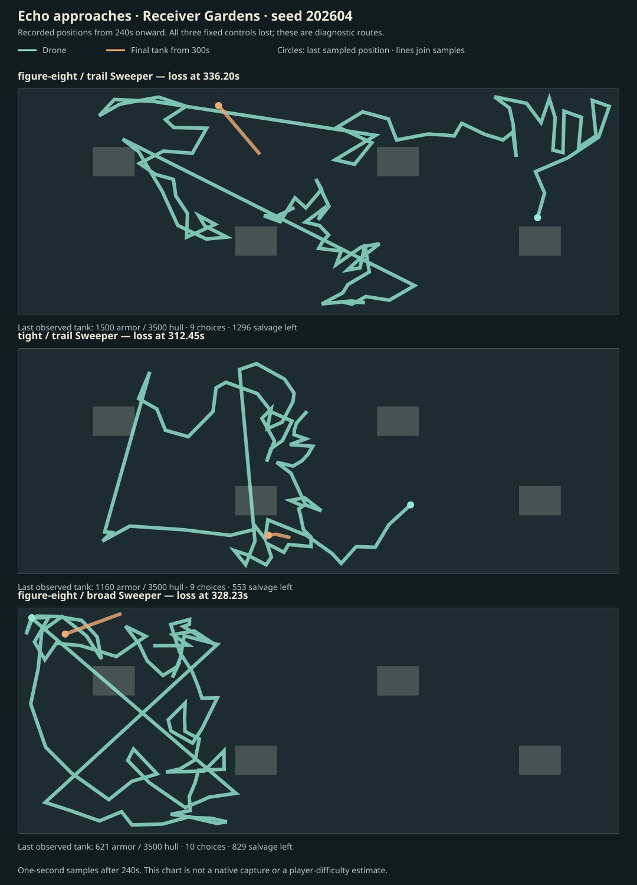
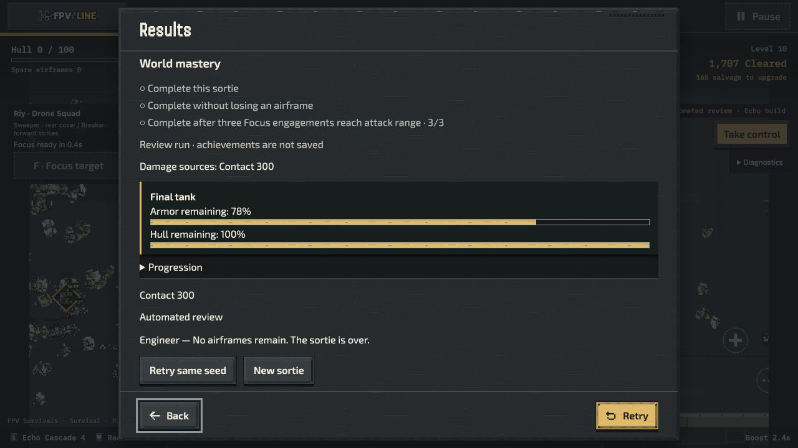

# Echo approach and flight-report follow-up — 15 October 2026

## Delivered

The native Single Drone/Riy flight report now shows the final tank's **remaining armor and hull**, with separate labelled meters in English/Ukrainian. It reads the actual final actor's stable identity and `hp`/`maxHp`; a missing, inactive unfinished or recycled actor is never displayed as a defeated tank. Raid retains its own objective report. Results are computed at display time; combat, upgrade thresholds, damage, records and save formats are unchanged. Runtime implementation: `d3e491db7`.

Review runs can now explicitly select `reviewRoute=tight` or `reviewRoute=figure-eight`. The same resolved value drives the flight pilot and downloaded provenance. Existing native reviews retain their tight default, and Raid retains its existing objective/pack controls. Manual retry removes the review override. Runtime implementation: `4e39ae330`.

The first inspection incorrectly suggested the historical native route label was wrong. Tracing the entry's additional pilot wrapper showed that it already forced the tight route. That diagnosis was corrected before publishing; no historical capture is relabelled. New integration coverage executes both actual native wrapper expressions and the identity function, preventing a route override from being silently discarded.

## Integration and checks

Started from attack-readability PR #1489, which merged at `4defb04b81`. Incorporated fetched main `691351e1d` through merge `cf301b2f3`, preserving pushed history. The current follow-up introduces no new rendering textures, downloaded assets, audio owners or gameplay rules.

- `checks.tap`: **54/54**, zero failed/skipped, covering results, records, attack feedback, cover and offline dependency closure.
- `route-report-checks.tap`: **42/42**, zero failed/skipped, covering explicit/default/Raid routes, native wrapper forwarding, report rendering and terrain-aware pilot behavior.
- `integrated-checks.tap`: **72/72**, zero failed/skipped, covering final combined host/results/records and offline closure. Cohorts overlap; do not sum them.
- Focused ESLint and diff whitespace checks pass.
- Tests were observed failing for missing report/route exports before implementation; passing receipts above cover the finished changes.

## Controlled approach diagnostics

Receiver Gardens, seed **202604**, Standard, three airframes. Every build and draft was earned. No grants, seed search, enemy adjustments, extra retries within a trial or damage buffs. The baseline preserves the prior figure-eight/Slowing Trail case; the two follow-ups each change one control: flight route, or Sweeper branch. All cases retain the same primary Echo and Breaker Burst preferences. Legal drafts and downstream encounter outcomes may diverge after the changed choice or route.

| Controls                     | Outcome      | Choices | Evolution | Last sampled tank armor / hull | Salvage collected / left at loss |
| ---------------------------- | ------------ | ------- | --------- | ------------------------------ | -------------------------------- |
| Figure-eight + Slowing Trail | Loss 336.20s | 9       | 113.18s   | 1,500 / 3,500                  | 1,621 / 1,296                    |
| Tight + Slowing Trail        | Loss 312.45s | 9       | 108.73s   | 1,160 / 3,500                  | 1,735 / 553                      |
| Figure-eight + Broad Sweeper | Loss 328.23s | 10      | 97.18s    | 621.28 / 3,500                 | 2,181 / 829                      |

The baseline reproduced the prior outcome exactly. After its last replacement it moved away from the final tank; its closest one-second sample was 382 units. It never damaged that target. The other two controls reached attack range and removed some armor. All three losses took 300 contact damage; warning attacks were not the source of those deaths. The baseline's last upgrade was at 249.25s, leaving an unfinished 86.95s interval before defeat. Its recorded completed-choice gap was 62.88s; these are different measurements.

These outcomes support investigating sustained clearing/collection routes and crowded approaches. They **do not establish that higher boss damage, more salvage drops or more hull would solve the issue**. Broad Sweeper earned ten choices yet still lost. Earlier accepted evidence already contains a Single Drone Echo completion on Haul Switchbacks and a Riy systems completion on Split Compound; this Receiver Gardens loss remains a specific unresolved case. Three fixed pilots are not player difficulty or enjoyment evidence.

The chart joins observed positions from 240s onward, with one-second samples after 240s. It is a route diagnostic, not native gameplay artwork or an assertion about safe paths. Gray footprints come from the compiled terrain. `summary.json` retains the derived measurements; the original compressed traces include controls, pending impacts, crowd proximity, damage causes, collected salvage and actual tank HP.

## Source boundaries

`echo-original.json.gz` and `echo-comparisons.json.gz` are the initial source-stable observations at head `a3c002b93`. Their probe files were subsequently formatted without semantic changes. The baseline was replayed with the formatted, committed probe as `echo-pinned.json.gz`: source-stable, same 336.20s outcome.

`comparisons-invalid-source-change.json.gz` is retained and **excluded** from qualification: editing imported `host-loop.mjs` during that repeat triggered the hash guard and failed the command, despite matching outcomes. The fresh repeat at runtime commit `4e39ae330` completed in 114.15 wall seconds with `sourceStable: true` and `complete: true` (`comparisons-fixed.json.gz`). Both outcomes, draft timings and tank states match the initial observations. Every recorded source hash also matches the preserved probe and current imported dependencies. No runtime file changed during the accepted repeat.

## Native evidence

`native-report-d3e491.png` and `.txt` preserve an ordinary native Riy review that earned nine choices, lost at the displayed **05:12**, and showed **78% armor / 100% hull remaining**. It destroyed 1,707 enemies and collected 1,735 salvage. Setup: Receiver Gardens, seed 202604, Standard, three airframes, Scout, normal effects, shared master muted. The page loaded the report implementation before the route-option follow-up; its controls use the historical tight default. This demonstrates the results UI, not a human playtest or performance trial.

`native-figure-eight.json.gz` is a separate 13.53-second native smoke check of `4e39ae330`: the downloaded identity explicitly records `route: figure-eight`. It was then paused. It is neither a completion nor timing qualification. The entry wrapper regression above verifies the same route reaches the pilot.

## Remaining priorities

1. **P1 balance/approaches:** Receiver Gardens Echo remains unqualified. Compare deliberate player-controlled clearing and return routes against these fixed controls; do not infer a blanket damage change from their losses. Preserve unattended regression coverage when changing actual combat.
2. **P1 readability/audio:** The final report now exposes the approach shortfall. Complete broader dense-scene visual review and audible full soundtrack/effects review; recordings that exclude music are not complete-mix evidence.
3. **P2 replay:** Review five-contract Marathon composition/refits and keep Time Attack medals provisional until player attempts justify them.
4. Preserve the unreproduced imported-mission anomaly; escalate immediately if actual retained-content loss is reproduced. Continue selected cross-mode polish after accepted Survivals presentation.

External devices and the five-player study remain **skipped at the user's direction, not passed**. This continuation makes no new all-mode offline, hardware, soak or enjoyment claim. All saved work is preserved; publication and further content expansion are separate actions.
