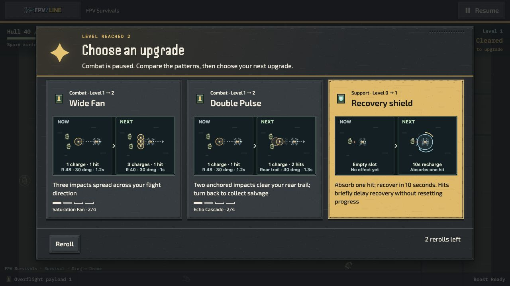
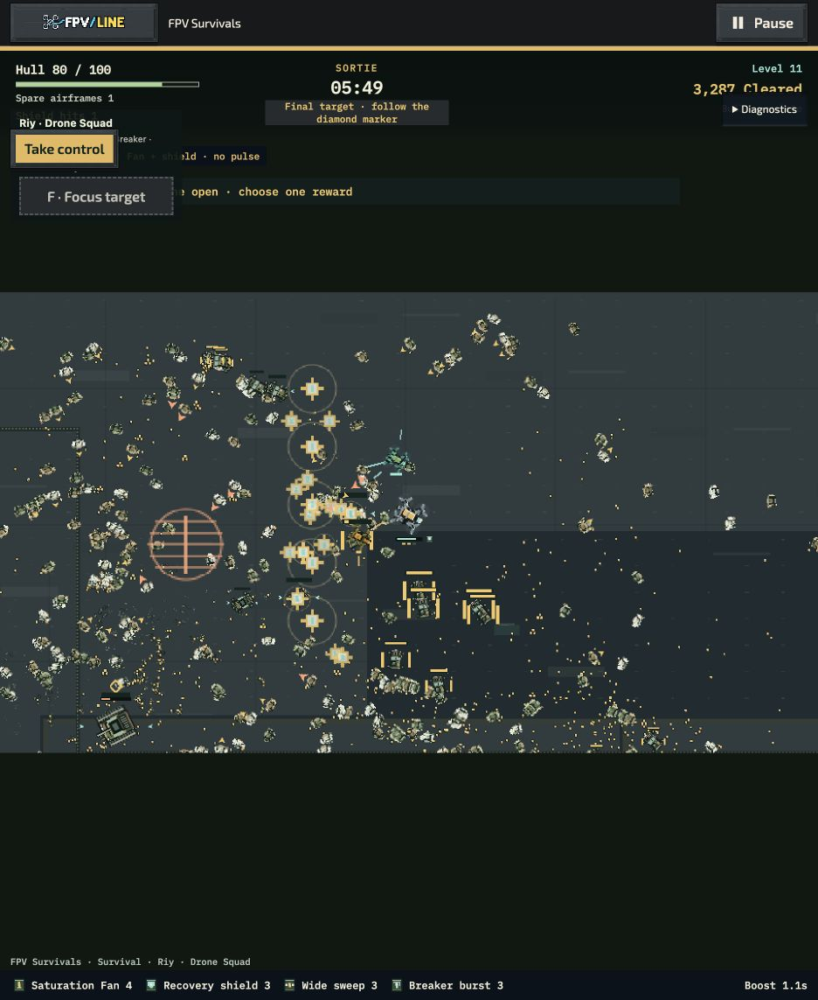

# Combat guidance, card previews and cover follow-up

Runtime: `60b0c25ab2703371691d4d203df7d5067638ca14`. Main `add8c95a1` is integrated at `895431b744040688da4ec6ec78a5bf617222d253`; that merge adds documentation only. PR1248 merged at `c337b5d06`, including the earlier Studio and qualification work. This follow-up contains the concrete defects found during the next review.

| Correction | Player benefit | Verification |
| --- | --- | --- |
| Survivor/Riy final-target navigation | A native target portrait inside a diamond points toward the required finisher near/off screen; an on-body diamond identifies it in view. HUD instructions cover custom non-tank bosses too. | Direction/edge, defeat/retry, reduced-effects and renderer-resource tests. One marker, at most seven pooled images; existing atlas frames, below hostile warnings and the player. |
| Salvage progress | Shows the exact collected-salvage shortfall for the next card, plus accessible progress. A completed build has an explicit label. | Threshold crossings, pending drafts, uncollected drops, retry and Ukrainian copy. No collection radius or reward changes. |
| Native upgrade comparisons | Uses the selected drone and enemy artwork through the existing prepared sprite callback. Corrected rear-release geometry and pickup-range demonstrations. | All legal preview families/branches, fallback, accessibility and reduced-motion tests. Tiny image strips are baked per card; staging canvases are released, with no new renderer or animation loop. |
| Riy cover handling | Escorts choose a clear shot instead of spending a cycle against a covered target. Chains select clear links and divide their existing damage among admitted victims. | Ten focused cover regressions, plus existing Riy/terrain tests. Focus can still approach around cover; legacy Riy V1 behavior and all damage/range/cadence values are retained. |
| Local warning audio | Inaudible distant charges cannot discard nearby warning cues or suppress local feedback/ambience. | Simultaneous near/far/local warnings, moving out of range, local damage priority and no stale-cue backlog. Shared mixer and soundtrack ownership remain unchanged. |

## Local checks and evidence boundaries

The combined targeted cohort passes **121/121 tests**, zero skipped. Formatting, ESLint and whitespace checks pass. The new HUD module follows the existing static dependency closure into the offline package. No new asset file or sprite-atlas page is required.

The previous CI failure came from a host-test execution context omitting the new delayed-benchmark variable. Both the independently pushed correction and expanded admission coverage are preserved; runtime initialization was already correct.

The [bounded Riy Echo regression](RIY-COVER-SANITY.md) repeats one locked earned case and its four original held-heading branches, plus a clearly labeled parked continuation. All five unattended continuations lose. The active run also loses at 243.60 seconds, with nine upgrades. The original branches retain their previous outcomes. This one-airframe case does not requalify replacement behavior or all builds, and does not establish ordinary-player balance.

Earlier native timing, soak and matrix receipts retain their own commits. They are **not relabeled as measurements of this cover-targeting fix**. The new source has focused correctness checks and native UI review, not another full performance or balance qualification. Human visual appeal, audible mix quality, route enjoyment and ordinary-player difficulty remain review judgments. External hardware and five-player trials remain **skipped at the user's direction, not passed**.

## Native UI review

The first manual Single Drone draft appeared at gameplay 16 seconds on Shelterbelt Gaps (Standard, three airframes, Scout, normal effects, mute). It contains native drone/enemy image strips in all three comparisons. Selecting Wide Fan returns to play with the same earned hull/state, level 2, Wide Fan rank 2 and 32 salvage remaining for the following draft.

The screenshot is a native gameplay dialog, not a generated concept. Current-to-upgraded descriptions remain available to assistive technology. It does not establish readability for every device or custom appearance.

The native Riy review reached gameplay 05:49 with the final-target instruction and diamond portrait visible. It retained ten upgrades and one spare airframe. This is a presentation observation, not a completed sortie or performance trial. [Capture settings](native/readability-review-60b0.json).

The original 30-file UI cohort passed 540 tests but could not load one file because the local checkout lacked the pinned `fake-indexeddb` dependency. Restoring that exact test dependency without changing tracked manifests allowed the isolated file to pass 37/37. The [recovered result](readability-recovered-aggregate.json) therefore covers **577 passing tests across the original and recovery executions**, not one all-green run. The original failure and logs are retained. Verifier/policy checks passed 13/13. Three new regression suites are now admitted to CI; their separate admission/check cohort passes 34/34. Counts overlap other reports and must not be added together.

As of the 15 October review, GitHub main has advanced to `33957174d7`. It contains PR1248 but not these corrections. No Overflight runtime file changed upstream after the integrated base; shared menu/input/style changes still require final integration checks. Earlier source attribution is retained.

The corrective delivery and this evidence are committed and pushed in [draft PR1319](https://github.com/mekhovov/revealline/pull/1319). The [15 October priority review](../../../fpv-survivals-review-2026-10-15.md) separates delivery tasks, remaining player-quality judgments and intentionally deferred work.
