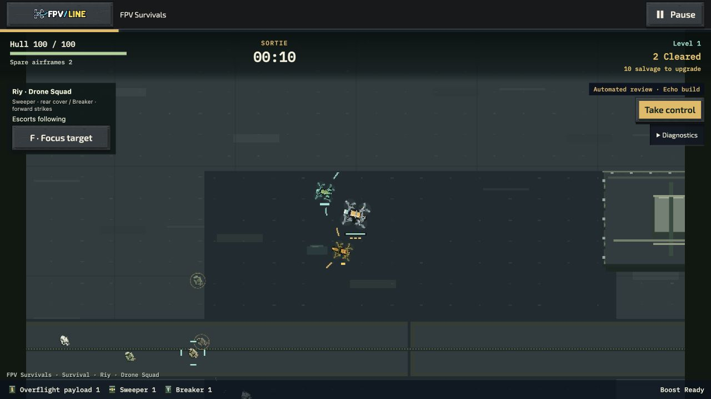
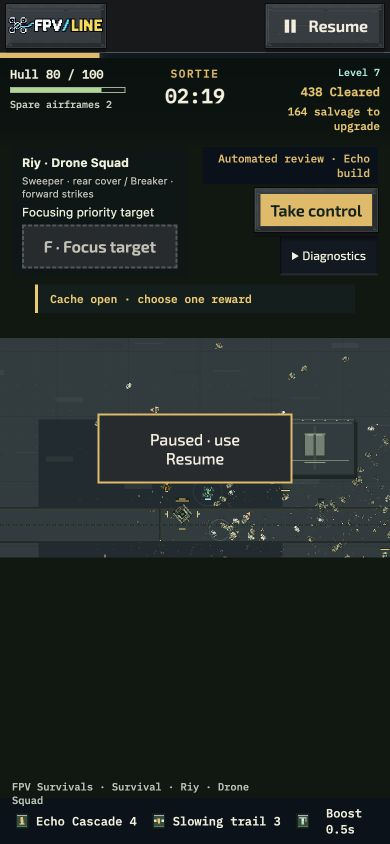
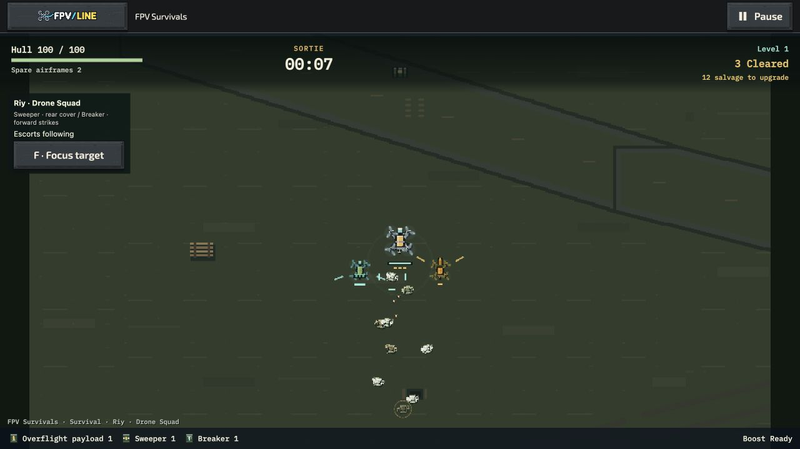

# Current-main quality follow-up — 15 October 2026

PR: [#1344](https://github.com/mekhovov/revealline/pull/1344).

## Integration and delivered changes

Fetched and rebased onto main `da0b010820`. There were no divergent local commits: the rebase advanced the checkout without rewriting pushed history. PR #1319 was already merged at `47c3e26e25`; the new work uses `codex/fpv-survivals-quality-followup`.

Runtime `5dfb60e7d8` separates the review controls and Riy squad controls below the HUD using normal layout flow, including wrapped labels. Diagnostics and Take control no longer cover salvage, squad status or each other. Both player HTML entries use the same structure. Native checks cover 1280×720 and 390×844; the temporary viewport override was restored.

The same commit fixes escort sound admission. Simultaneous audible shots alternate the eligible escort role, preserving the shared 0.65-second cap. Distant shots cannot consume that slot; suppressed shots never backlog; warnings retain priority and retry resets history. This changes presentation only, not fire rate, damage, targeting, randomness or gameplay records.

Commit `0ee5d73c82` explicitly checks that the new HUD, world audio and native preview dependencies belong to the offline source closure. Runtime files are identical to `5dfb60e7d8`.

## Checks

- Integrated main before edits: **121/121** focused tests, zero skipped (`integrated-da0b.tap.gz`).
- Changed audio, host, HUD and offline closure: **61/61**, zero skipped (`quality-checks.tap.gz`).
- Explicit offline dependency assertions: **15/15**, zero skipped (`package-closure.tap.gz`).
- Cover, native cards/previews and Raid variants: **37/37**, zero skipped (`replay-checks.tap.gz`).
- Focused lint and diff whitespace checks pass. Test cohorts overlap; do not sum them.
- Two initial commands named nonexistent test files and stopped before test execution. Corrected commands produced the successful receipts above.
- Native Contract Marathon started through its shared shell and reached 01:15, six kills and one replacement before explicit pause. This is a shell/control smoke check, not a contract-completion claim (`marathon-shell-0ee5.jpg`).

## Narrow native performance check

`native-opening-5dfb.json.gz` is the complete UI-downloaded raw record. `native-opening-5dfb-summary.json` is the visible diagnostic summary. Runtime files did not change during the trial.

Apple M4 Pro, macOS 26.7.1, Codex Chromium 155, 1280×720 CSS viewport, DPR 2, 960×540 backing. Riy Echo, Receiver Gardens, Standard, three airframes, Scout, normal effects, muted shared master; seed **17031991**. Thirty seconds warm-up, then one 120-second measurement. The benchmark pauses explicitly at completion.

| Measurement                                | Result                 |
| ------------------------------------------ | ---------------------- |
| Completed-render cadence                   | 119.74 FPS             |
| Frame interval p95 / p99                   | 10.0 / 16.1 ms         |
| Frames above 33.3 ms                       | 0.355%                 |
| Worst interval                             | 149.7 ms, retained     |
| Upgrade-phase wall time within measurement | 7.50 seconds, included |
| Dropped simulation time / context losses   | 0 / 0                  |
| Peak alive / visible / rendered            | 175 / 110 / 118        |
| Base atlas plus world RGBA                 | 28,467,840 bytes       |

The window passes the local thresholds, including the recorded foreground stalls. Headless diagnostics and production preparation overlapped part of this trial; it is not a controlled before/after speedup comparison. It is **one opening changed-flow trial**, not three full-content trials, a late horde test, a new soak, or qualification of Iris Xe/Safari. The initial native review lacked the finite `trial` parameter and is not counted as benchmark evidence. No video was recorded during the measured trial.

## Build comparison boundaries

The fixed case list was selected before execution: Receiver Gardens, seed 202604, Standard, three airframes, figure-eight public-input pilot, fan/echo/systems in Single Drone and Riy. No grants, favorable-seed search, enemy changes or damage buffs. Drafts are earned and selected legally.

`build-comparison-da0b.json.gz` exhausted its explicit 240-second wall budget. Its source hashes remained stable. Single Drone completed all three cases: fan won at 357.38 seconds (longest draft gap 50.15s); echo lost at 316.33 (66.97s); systems won at 387.22 (46.85s). Each earned ten choices. Riy fan stopped at 132.05 gameplay seconds; Riy echo and systems did not start. Those entries are censored, not losses. The exact initial probe is preserved in `build-comparison.mjs`.

The follow-up `riy-build-comparison.mjs` repeats only the same three predetermined Riy cases with a 900-second wall budget. No route or gameplay tuning was introduced between attempts.

It completed all three cases in 610.21 wall seconds with stable source hashes (`riy-build-comparison-0ee5.json.gz`):

| Riy build                                       | Outcome       | Choices | Longest interval between earned drafts |
| ----------------------------------------------- | ------------- | ------- | -------------------------------------- |
| Fan / broad Sweeper / burst Breaker / Shield    | Win, 377.97s  | 10      | 65.25s                                 |
| Echo / slowing Sweeper / burst Breaker / Shield | Loss, 336.20s | 9       | 62.88s                                 |
| Fan / broad Sweeper / chain Breaker / Scanner   | Loss, 367.33s | 10      | 49.83s                                 |

The Echo route stayed far from the boss: sampled distances were 1,389 and 1,792 units at 315 and 330 seconds; armor remained 1,500. It had 744/1,027 uncollected salvage in those samples. The result supports an approach/collection investigation, not a conclusion that higher damage solves it. The systems route reached ten choices and still lost, with final armor 1,240.26 in its last two samples. All Riy damage in this fixed comparison was contact damage. Across the completed six cases there are three wins and three losses, not six validated techniques or a player success-rate estimate.

Probe limitations: `build` in each result holds the final build object; the intended family is preserved in the fixed probe case order and console receipt. Boss samples capture distance and armor, but the attempted hull/health fields do not match the runtime's `hp` property, so these files **do not establish boss HP traces**. Overall damage, outcomes, drafts and positions remain available. Fixed pilots establish diagnostic outcomes, not ordinary-player difficulty or enjoyment.

## Sound review artifact

[Twenty-second native Riy effects/voices clip](riy-effects-5dfb.webm), VP9 960×540 with stereo Opus 48kHz. Recorded **after** the benchmark was downloaded and frozen; the captured benchmark has `clipCaptureUsed: false`. The later recording is not performance evidence.

Shared master was unmuted at its existing 0.65 volume, effects 0.7, music 0.55, Humanoid reactions selected. The soundtrack UI showed Carol of the Bells (Metal Version) by Alexander Nakarada playing. The recorder intentionally excludes external soundtrack/HUD/cards, so the file is a focused effects demonstration, **not a complete-mix audibility pass**. Media analysis confirms non-silent audio (mean −47.8 dB, peak −28.8 dB), not subjective sound quality. The download interaction initially timed out; the completed DOM media link was recovered and saved through the browser's media-download action. Shared mute was restored before leaving the page.

## Current-source cached launch

The unmodified production preparation completed for runtime/test commit `0ee5d73c82` (version 0.151.1), build `62c6264f60c9bb3adb4f48c10601969db57b6cb9c5a12bedf30b1b103b89e9b2`. `offline-build-0ee5.json` records 1,693 mandatory files / 66,694,405 bytes and exact SHA-256 pins for the corrective HUD, world audio and upgrade preview modules. Preparation served the real generated entries from memory, without bypassing validation or creating another expanded site/ZIP.

On the fresh localhost port 8951, the ordinary Downloads UI selected **Survive · all Overflight operations** alongside the required Solo Starter. It displayed up to 106.6 MiB, then **Your selected game is verified and ready offline** (`offline-installed-0ee5.txt` and screenshot). No optional soundtrack was downloaded.

The qualification host then returned HTTP 503 for every game resource. A direct origin request confirmed 503. Fresh navigation to `play.html?operation=riy&lang=en` opened the normal family Home; Start launched Riy through the cache. After seven gameplay seconds the native HUD showed 100 hull, two spare airframes, three destroyed enemies, the salvage meter and both escort roles. The run was explicitly paused. `offline-origin-0ee5.json` records the unavailable origin and three rejected requests; UI receipts and `offline-riy-playing-0ee5.png` preserve the result. The origin was restored afterward.

This passes the requested **bounded current-source cached-launch check**. It is not a new all-five-operation, existing-cache-update, imported-mission retention, OS installation or physical-device qualification. Earlier broader evidence keeps its original commit identity.

## Remaining acceptance

Do not mark the overall plan complete from these checks. Echo approaches/build viability, full soundtrack audibility, representative full-build visual acceptance and player-calibrated medals still require their stated reviews. The existing imported-library anomaly remains unreproduced; no speculative migration was made. External devices and the five-player study remain **skipped at the user's request**, not passed. More maps, modes, permanent progression and character mechanics remain deferred.
