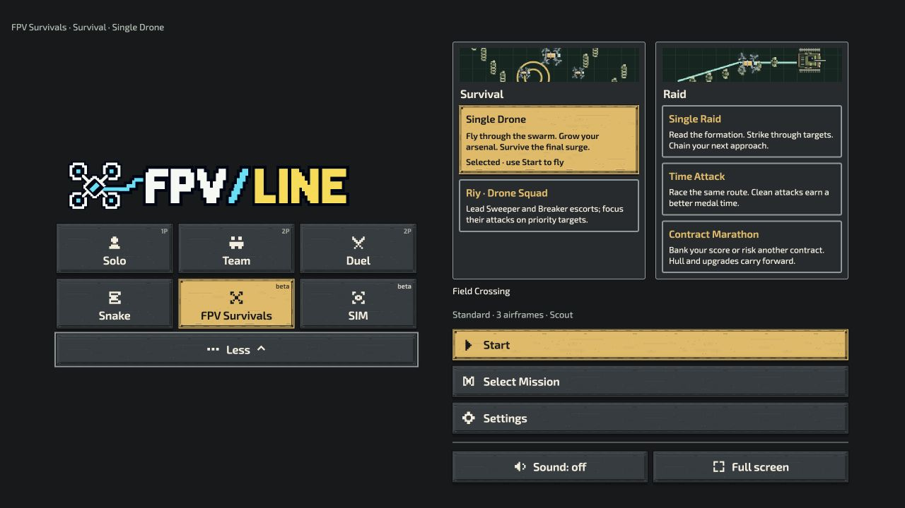
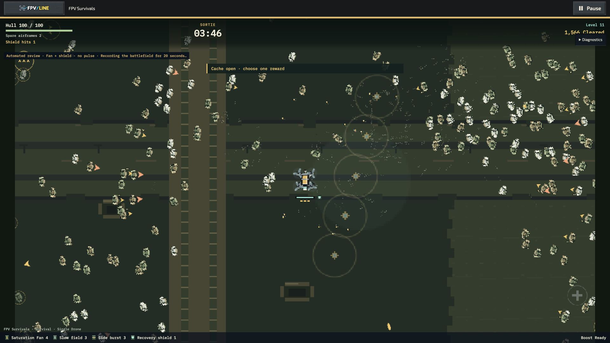
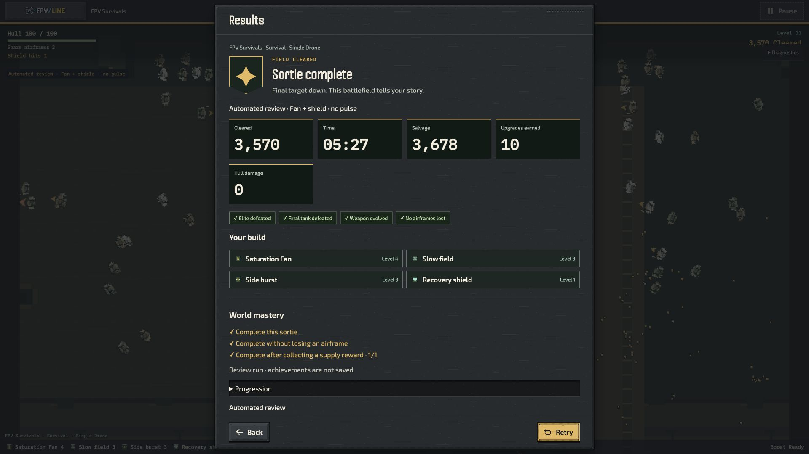

# FPV Survivals — worlds and combat presentation

[Worlds PR #1192](https://github.com/mekhovov/revealline/pull/1192) is stacked on [rebalance PR #1183](https://github.com/mekhovov/revealline/pull/1183). Both include main through `460169d79`. First implementation: `218675159`. Integration `c375324951b4b510e8dd5a1814289da287300d2d` and stack-only merge `fb1ede1e761dd04403d9a694df46bd968f42b7a8` have identical feature source files. Final runtime source revision: `a539ccde4d2390ee74a717a076f43926f46952b2`. Test-only follow-up `dece9da68922743c73dc6cc2697a0aa9783b5326` corrects the optional-package envelope assertion from 128 to 133; gameplay source is identical. Later qualification below records its own revision; earlier captures are not relabeled as final-source measurements.

This is a playable review candidate. Implementation, automated correctness, native review and subjective acceptance are separate statuses. It is not presented as a fully qualified release.

## Delivered behavior

| Area | Implemented result | Evidence / remaining review |
|---|---|---|
| Family Home | One family, two groups and five explicit choices. Selection waits for Start. Missions return to Home. | Native Home/mission screenshots and shared navigation tests. |
| Rules and records | Built-in Raid current rules; variants query the revision they save. Legacy imports retain their rules. Cosmetics preserve gameplay identities. | Project, package, records and host tests. |
| Three worlds | Field Crossing, Freight Depot and Relay Ruins: materials, landmarks, thumbnails, ambience and authored role mixtures. Tall scenery stays at edges. | Native Studio/installed-world screenshots and exported packages. |
| Encounters | Six combinations; committed Depot convoy stops; two existing supply opportunities become guarded encounters without added rewards. | Simulation tests and route evidence. |
| Combat presentation | Native states follow simulation; distinct Riy assemblies; custom images/clips and world artwork feed runtime preparation and upgrade previews. | State, atlas, override and compatibility tests; native clips. |
| Atlas | Deterministic pages within device limits/2048px, stable references, bounded sprite budget, one-time selected-scene preparation, recovery and disposal. | Stock scene: 1,327 frames; 2040×1964 sprite page = 16,026,240 RGBA bytes. Six ground tiles add 12,441,600 bytes separately. Recovery canvases are also counted separately. |
| Progression | First six thresholds unchanged; later choices need less collection. Earned/collected/ground/nearby reachable salvage measured separately. | Same-seed diagnostics. Reachable is geometric, not necessarily enemy-free. |
| Results | Three optional mastery goals, chosen build, damage, supplies and same-seed comparisons. No stat bonuses/currency. Bounded recent-context retention. | Mastery tests and native result. |
| Sound | Main launch/rotors, world ambience, state warning cues, bounded escort/reaction voices and priority mix. Classic/Reactions independent of gore. | Tests and recorded native effects; human mix acceptance open. |
| Studios | World preset selection (including its palette/ambience), editable regions and landmarks, explicit encounter application; exact dependencies; native previews/import/export; optional artwork admission with Undo. | Creator round-trip and package tests. Independent palette/ambience controls are not claimed. |
| Terrain experiment | Six permanent obstacles/two two-hit barriers; sliding, cover, navigation, safe replacement/rewards. Only Single Drone, Riy and Single Raid. | Tests, short native runs and three full terrain-aware automated completions; native full-sortie balance still needs review. |
| Cross-mode reuse | Opt-in materials in Solo/Duel, Team, Snake and SIM through existing presentation owners. | Native Solo/SIM and merged-source checks. This is not a complete new animation rollout in every mode. |

## Native review gallery

These are actual runtime captures, not generated concept art.

- [Opening combat](fan-opening-native.webm), [evolved combat](fan-evolved-native.webm); these two clips have no sound.
- [Riy opening with sound](riy-field-opening-audio.webm), [developing run](riy-field-developing-audio.webm), [approach](riy-field-approach-audio.webm), [elite](riy-field-elite-audio.webm).
- [Normal effects](fan-normal-effects-audio.webm) and [reduced effects](fan-reduced-effects-audio.webm) in an earned late Fan run. These are different intervals of the same run, not frame-identical views. Both include effects audio and exclude external music.
- [Raid machinery and armor sounds](raid-armor-audio.webm), [Raid listening copy with +24 dB](raid-armor-listening-plus24db.mp3).
- [Listening copy](riy-opening-elite-listening-plus24db.mp3) uses explicitly documented +24 dB gain; it is not the runtime mix.
- [World missions](world-missions-fresh.jpg), [selected Depot](family-home-depot-selected.jpg).
- [Field Studio](studio-field-marathon.jpg), [Depot Studio](studio-freight-marathon.jpg), [Ruins Studio](studio-relay-marathon.jpg), [installed Ruins Time Attack](installed-relay-time-attack.jpg).
- [Experimental Raid](experimental-raid-native.jpg), [Single Drone](experimental-survival-native.jpg), [Riy](experimental-riy-native.jpg).
- [Asset Studio admission](asset-studio-admitted-artwork.jpg).

Native Fan review completed in 327 gameplay seconds with 3,570 kills, ten choices, 3,678 salvage and no hull damage: Field Crossing, seed17031991, Standard, three airframes, Scout/standard handling, Fan+shield without Pulse. This used the explicit review pilot. Recording/context recovery make it unsuitable for performance qualification.

## Balance findings

The final 99-case matrix has 27 active routes and 72 branches switched at 180 seconds to no input, tiny circles, wall-held input or simple orbits. All 72 reached the checkpoint, continued resolving drafts/replacements and lost. Active routes completed 24/27. Exact settings/hashes are in `gameplay-probes-final.json.gz`.

An additional 18 cases reached 120/240-second checkpoints and lost after stopping input: Veteran/Fan, one airframe, every world and Survivor/Riy, plus second-seed Standard/Echo. This extends coverage; it is not every possible setting combination.

Depot originally assigned every ordinary flanker to a fast family. Correcting its mixture to patroller/courier/radar-truck restored slower pursuit and bounded standoff support without increasing friendly damage or reducing arrivals. Survivor Echo then completed both measured seed17031991 routes and an alternate seed17 route.

Final matrix failures remain retained: Depot Survivor Systems, Riy Echo and Riy Systems. Further public-input diagnostics produced two Depot Riy Echo completions in 433.7–440.2 seconds using a lure-and-return route, and a Survivor priority-target completion in 357.2 seconds with earned evolution, Scanner and directed Side Burst. Riy priority routes and the second-seed Riy Echo route still failed. No production pilot or damage changes were made to obtain these results; broader route robustness remains unqualified.

Earlier working-tree checks completed all three Raids with the baseline kit under the objective pilot: seven objectives/no damage. Their pre-reconciliation hashes are retained in `raid-baseline-worlds.json`; these are historical reachability checks, not a rerun of final source `a539ccde4`. Approximately 23-second automated times do not establish ordinary 4–7-minute first-completion pacing.

See [balance review](balance-review.md). Older `gameplay-probes.json.gz` remains implementation history, not final evidence.

## Evidence revision boundaries

- The 99-case matrix was written at `fb1ede1e7`. Every listed simulation source hash still matches final source `a539ccde4`; this comparison does not rebind its browser/UI evidence.
- The 18-case extension records `c37532495`. Its later differences are the app, mission-library and actor-override modules; its listed simulation bindings still match. It is not a final UI regression run.
- Creator/package, initial Riy audio, cross-mode and accelerated lifecycle checks record a working tree based on `29e3bd4a8`. Their detailed reports preserve that attribution.
- Native restarts record `eeb779b4b`; the Raid audio clip records `c90a4a663` and predates the final shared audio-priority correction. The reference soak was loaded before reconciliation and is diagnostic only.
- Experimental Raid probes and late normal/reduced-effects clips explicitly record `a539ccde4`. Screenshots or receipts without a commit binding remain visual review evidence, not final-revision correctness or performance proof.

## Correctness and compatibility

- 512 integrated tests passed before final reconciliation ([raw log](integrated-tests-premerge.tap)). Later merged-source cohorts cover navigation, mastery, actor leases, Snake/SIM reuse, remaster compatibility and sound. Cohorts overlap; do not sum them as unique tests.
- A final compatibility audit also preserved same-image machinery crop, pivot and occupied-bound edits through the shared industrial adapter and Overflight aliases. Twenty-three focused tests pass; untouched stock art still uses native machinery.
- New optional actor slots initially blocked old Solo artwork. The fixed historical lease remains unchanged; optional slots load through full/board preparation. Regression and native Solo now pass.
- Graphics tests cover small-device pages, complete draw lists, custom clips, context rebuilding and disposal. Accelerated reference/stress/Raid checks cover pools and deterministic retries.
- Ten native restarts retained one gameplay canvas and 16 total canvases, with a reset clock each time: [retry receipt](native-retries.json).
- Native context recovery rebuilt owned textures and required explicit Continue: [receipt](graphics-recovery-native.json), [restored scene](graphics-restored-awaiting-continue.jpg).
- Creator import used an empty mission library on a second origin, not a new browser profile. Re-exported Ruins bytes match. See [Creator report](creator-native-review.md).
- Latest main's Snake floor plans, structure art, 240 missions, 35 chapters and v5 catalogue remain intact. See [reuse report](cross-mode-reuse.md).
- English/Ukrainian localization validation passed after guided-terrain strings were added: 13,029 messages, 9,026 references. Optional package closure and generated audio projection checks pass; 66 offline worker/destination checks pass. The final four package-count/closure checks pass; the 20 MiB budget is unchanged.
- Final audit fixes have focused regressions: player damage cannot be masked by the previous frame’s friendly impact (42 audio checks); incompatible installed terrain cannot break variant discovery/progress (26 focused checks plus host regression). The native Time Attack and Marathon chooser both retained the unavailable custom row alongside three playable worlds. [Native compatibility](installed-terrain-time-attack-unavailable.jpg).
- The merged compact Home was checked again at 1280×720: Settings remained visible at y=591–635 with a 44px target. [Merged Home](family-home-merged-1280.jpg).
- Guided terrain authoring was verified natively: Add cover retained the world; Validate accepted seven objectives; Time Attack made terrain read-only; moving a permanent obstacle into the central passage was rejected and restored its previous coordinate. [Controls](guided-terrain-studio.jpg), [rejection](guided-terrain-validation.jpg).
- The native 30-second warmup plus 15-minute measured reference soak completed: 1,500 alive / 700 visible / 700 rendered, no dropped simulation time, no sample overflow, one gameplay canvas, stable 1,845-sprite pool. Atlas bytes stayed constant. Concurrent CPU work means its timings are diagnostic. [Summary](native-reference-soak-summary.json), [raw receipt](native-reference-soak.json.gz).

## Remaining qualification

- Native upgrade from an older installed cache and interrupted-update recovery. Fresh packaged installation and server-stopped launch checks now pass for all five operations and Snake; see [offline review](offline-native-review.md).
- Three separate native two-minute trials with 30-second warmups; full-content/stress receipts. The app could not keep this chat’s browser foreground: the attempted short trial throttled to about 1 FPS and dropped 92.7 seconds. Its raw receipt is retained as invalid; it is not a game-performance failure or a pass.
- Complete before/after, active/unattended, three-technique and normal/reduced-effects comparisons.
- Native full-terrain completion, adaptive Depot control-build review and cross-mode movement review. The original pilot stalled at cover; an evidence-only terrain-aware pilot completed all three seeds with normal contacts, seven objectives and seven armor breaks. The three routes retained intact barriers. A follow-up broke one barrier with two fresh boosted passes, received no combat-resource rewards, crossed the opening and completed all seven objectives. These establish automated reachability before and after destruction, not human readability. [Original terrain probes](experimental-raid-probe.md), [intact routes](experimental-raid-navigation-probe.md), [opened route](experimental-raid-barrier-probe.md).
- Human review of the audible Raid armor/final-tank capture and warnings against native music. Existing recorder excludes the separate recorded-music element; clips cannot prove that full mix.
- Full state-animation adoption in other modes follows acceptance of FPV presentation; material reuse/current shared reactions are delivered.

Iris Xe Windows, M1 Safari, physical controller/phone and five-player trials remain **skipped at the user's direction, not passed**. Local evidence establishes correctness and exposes problems. Enjoyment, appeal and ordinary-player difficulty remain review judgments. Music intensity changes remain downstream of audible-mix acceptance.

## Build environment

The full distribution at `c90a4a663` completed preparation and optional-package admission, then hit `ENOSPC` while writing the download archive. The builder removed its own failed staging output; no source or other project data was deleted. The final numeric-version distribution was prepared successfully using the unchanged framework ZIP encoder on mounted storage. The review server serves only sealed ZIP entries, avoiding slow individual-file writes without falling back to the source tree. SHA-256 readback matches the [receipt](distribution-dece9da68.json). The [failed build log](build-c90-local-disk-failure.log) is retained as an environment failure, not a successful build.

The temporary main-baseline copy was archived to the mounted review storage and every one of its 4,118 file/symlink entries verified before removing that local copy. [Relocation receipt](baseline-relocation.json). The active worktree, commits and other projects were not removed.

The first sealed review archive used an unsupported prerelease version suffix. The offline installer correctly rejected it before installation; [captured rejection](offline-invalid-review-version.jpg). This was a review-producer configuration error, not a runtime change. The producer was rerun successfully with numeric version `0.151.1` and the same runtime source; all five operations and Snake subsequently launched with the server stopped. The rejected archive receipt remains for provenance.
