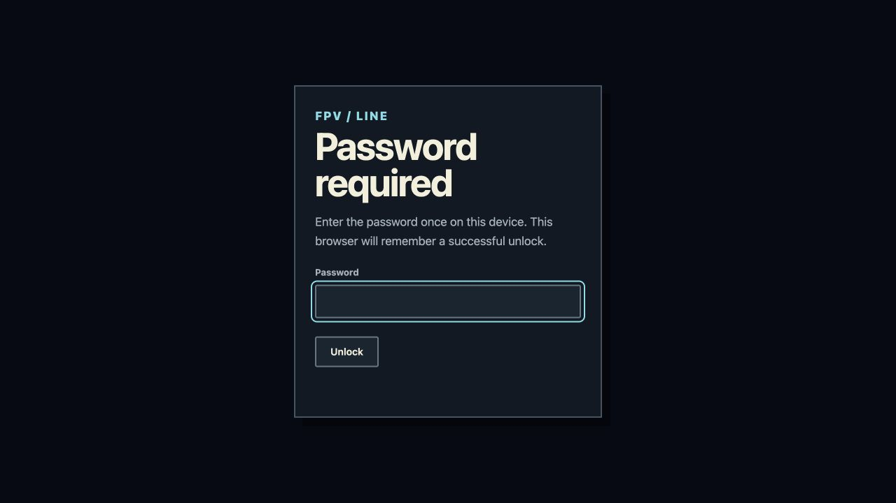

# Password gate coverage — 14 October 2026

The requested scope is the existing browser password gate on GitHub Pages. The user explicitly chose to retain GitHub Pages after being informed that this is not server-side access control. The password and remembered-unlock key are unchanged.

## Completed

- Applied the shared gate to all 66 current source entry pages: Solo, Team, Duel, Snake and its hub, Survive, Raid, both SIM applications, legacy civilian flight, guides, community pages, editors, tools, downloads, recovery, About and the offline launcher source.
- Pages begin locked with an inline visibility rule. Executable page scripts remain inert until the password succeeds, including inline startup code and legacy redirects. Missing gate JavaScript, missing crypto/configuration and wrong passwords do not start the page.
- Preserve the existing once-per-browser/origin unlock. Blocked storage still permits the current visit after a correct password, without promising persistence.
- Restore classic scripts before deferred/module scripts and preserve their attributes/currentScript. Solo waits for the delayed renderer and no longer misses the document-ready event.
- Protect generated privacy, credits, launch and update pages before cache/manifest hashes are calculated. Protect the release-directory page generated by the main Pages workflow as well.
- Include the shared gate in standalone SIM package dependencies and launcher caches, within existing file/byte budgets. Verify final launcher cache descriptors against the protected bytes.
- Add source inventory, password behavior, generated-page, renderer timing and cache-integrity regression checks. The refresh script synchronizes the shared configuration from `game/index.html` without changing the current credential.

## Verification

- 78 focused tests passed: password behavior, all source entries, boot, build/release fixtures, optional package admission/reproducibility, launcher health and main Pages profile.
- 188 additional regression tests passed: game page delivery, optional offline access, landing structure, Snake, Survive, SIM and civilian-flight UI. These suites overlap; the counts are not a unique combined total.
- Final gate projection tests: 8 passed, including configuration propagation and exact offline launcher hashes.
- Full main-pages preparation completed: 68 HTML pages, every page protected and no executable page script before unlock. See `build-page-audit.json`. The publishing workflow separately protects its generated release directory.
- Live fresh-origin checks: Solo, Team, Duel, Snake, Survive, Raid, SIM Worlds, SIM Academy, Studio, Downloads and About show only the password screen. The only active script before unlock is the gate.
- Live wrong-password check: rejected, input cleared/refocused, page stayed locked.
- Existing remembered unlock opened Snake. An isolated localhost preview with a test-only credential verified successful entry and subsequent remembered access to the Solo, Team, Duel, Snake, Survive, Raid, SIM Worlds and SIM Academy menus. Production credentials were not changed or recovered. Temporary test previews were stopped after verification.
- ESLint, Prettier, source gate inventory and whitespace checks passed.
- Updated an existing launcher-health VM fixture to account for two imports already present on main; it previously failed to parse the unchanged launcher source.

## Remaining and boundaries

- Merge and deployment are still required before this reaches the hosted site; local/PR checks are not public deployment acceptance.
- This gate does not make static HTML, scripts, assets or GitHub downloads private. The browser verifier/storage implementation remains bypassable by someone controlling their browser, as discussed with the user. Server/edge authentication remains a separate hosting decision.
- Previously downloaded copies, immutable historical releases and old service-worker caches cannot be retroactively changed. Users need the updated build; this is not a claim that every historical copy is protected.
- Offline cache contents and hashes were checked programmatically. A new physical-device installation, retained-client upgrade and airplane-mode acceptance pass were not performed.

