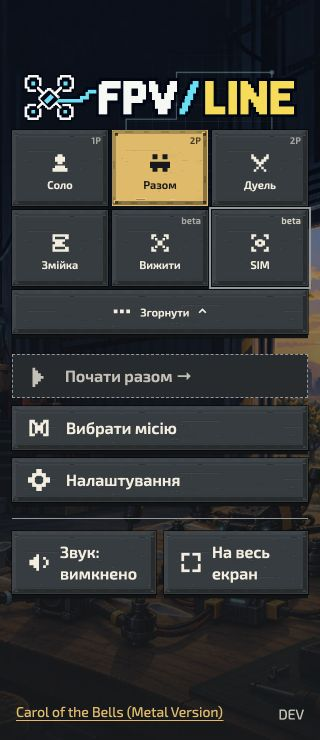
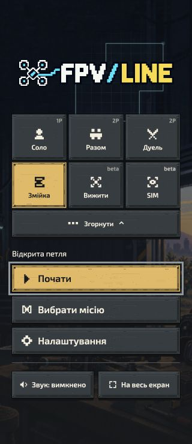
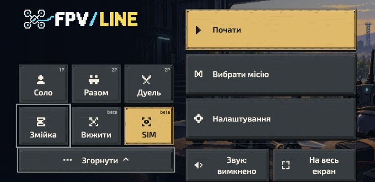
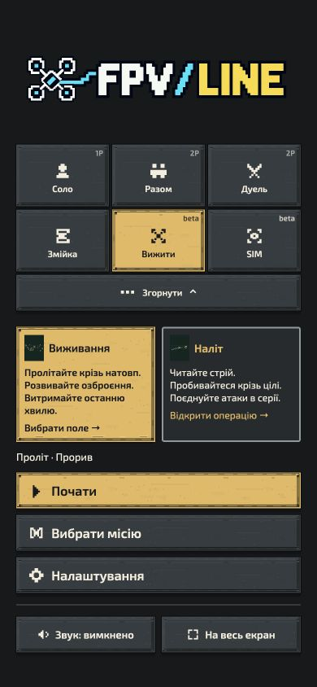

# Compact shared game chooser — 13 October 2026

## Completed

- Primary chooser: Solo, Team, Duel, More. English Duel and Ukrainian Дуель replace the abbreviated VS label; internal mode IDs and saved-game routes remain unchanged.
- More expands to two rows of three game icons: Solo / Team / Duel and Snake / Survive / SIM, followed by a compact collapse control. Secondary-mode homes start expanded so the active mode remains visible. Collapsing them returns focus to More.
- Survive (Вижити) replaces Overflight in the shared chooser and player title. Survive and SIM carry visible and accessible beta labels.
- The separate Raid shortcut is removed from the shared landing. Survive's home contains compact Survivor / Raid operation cards. Raid stays within Survive, rather than becoming another top-level game mode. Both operations preserve their routes and existing mission selection.
- Shared native buttons/links preserve pointer, touch, Tab, Enter/Space, keyboard, controller/D-pad and radio-adapter activation. More exposes aria-expanded and aria-controls. Hidden destinations leave the active navigation path.
- Horizontal traversal follows the visible choices and wraps. Down from a selected mode retains Start/Continue → Missions → Settings → Sound → Fullscreen → selected mode. If the active secondary mode is collapsed, the final step returns to More. Expanding More restores the active secondary mode, or focuses Snake from a primary mode. Up from Less enters the secondary row; Down enters the actions. Survive inserts the selected operation before Start/Continue, with left/right reaching the other operation. A visible Results action is also included after Start/Continue.
- Escape/Back from the chooser collapses it. Nested Settings, paused flights and result screens retain their original Back behavior; the disclosure cannot steal a different surface's focus.
- Hover does not impersonate the selected mode. Shared utility text fits narrow Ukrainian layouts without splitting words into single letters.
- Settings dropdowns, sliders and checkboxes now use arrows for navigation until Enter/Confirm starts editing. Enter applies and Escape/Back cancels. Native typing and ordinary forms remain unchanged. Pointer/touch still use their native controls.
- Settings sections can exit to Back at the last field, including SIM layouts with Back above the fields.
- The canonical changes are projected into standalone SIM assets with the existing generators.

## Verification

The original compact chooser shipped in [PR #1161](https://github.com/mekhovov/revealline/pull/1161), which is merged. The navigation follow-up was updated by fast-forwarding to main `f4f70ef6fcd0f4345668c7d1e6f865798301f559` before final qualification.

Final focused suite: **521 passed, 0 failed, 0 skipped**. It covers the shared chooser and shell, all six mode focus states, core/Snake/SIM integrations, controller navigation, keyboard Settings editing, Survive/Raid operation selection, radio input and optional-core admission.

```sh
node --test --test-concurrency=2 \
  game/test/mode-choice-view.test.mjs \
  game/test/mode-choice-appearance.test.mjs \
  game/test/mode-play-shell.test.mjs \
  game/test/couch-shell.test.mjs \
  game/test/civilian-practice-ui.test.mjs \
  game/test/native-landing-structure.test.mjs \
  game/test/native-landing-fullscreen.test.mjs \
  game/test/classic-snake-ui.test.mjs \
  game/test/fpv-flight-ui.test.mjs \
  game/test/fpv-world-appearance-ui.test.mjs \
  game/test/overflight-host.test.mjs \
  game/test/overflight-controller.test.mjs \
  game/test/overflight-raid-presentation.test.mjs \
  game/test/overflight-variety-presentation.test.mjs \
  game/test/controller-navigation.test.mjs \
  game/test/fpv-menu-keyboard.test.mjs \
  game/test/mode-settings-view.test.mjs \
  game/test/fpv-radio.test.mjs \
  scripts/test-optional-core-tools-boundary.mjs
```

An earlier broader run included modal and couch composite navigation: 573 passed and one failed. The failure, “Collection resets its return label from Settings to a direct paused-flight visit”, also reproduced in an isolated copy of unchanged main. Its setup assumed title Start immediately entered flight, although the current product opens a ready briefing. The test now performs the existing explicit briefing launch before checking Collection return behavior. Its focused rerun passed (1 selected test; 54 intentionally excluded by the name filter). This changes only the test setup, not launch behavior.

ESLint and formatting cover changed authored modules. SIM generators confirm byte-identical output. EN/UK localization validation passed (13,029 messages, 9,026 references). Diff whitespace checks passed.

Browser verification used isolated localhost previews:

- Original chooser review: Team EN/UK at 320px; Snake and Survive UK at 320px; SIM UK at 740 × 360; Duel UK at 320px/1280px. Live expansion/collapse and six-step loops were checked on Snake, SIM and Duel.
- Follow-up: Survival and Raid at 320px/390px. Keyboard right + Enter switches operations while preserving Ukrainian; mission selection returns to its operation opener on Escape. The seven-step Down loop includes the selected operation, and focus scrolls off-screen utilities into view. Ukrainian operation names fit on one line with no horizontal overflow.
- More restores the selected Survive/SIM choice on reopening; Less moves down into the actions.
- Snake: reverse Home loop and shared Settings categories. Down crosses dropdowns and sliders without changing their values and reaches the footer Back button; Enter then Escape restores the Settings opener on Home.
- SIM: shared Home loop; keyboard Enter starts an edit and Escape restores its original value while remaining in Settings. Down from its last control reaches the header Back button.

## Remaining / limitations

- Physical controllers, radio transmitters and touch hardware were not available for this run; controller input is covered by simulated host tests. Responsive browser inspection does not claim physical-device qualification.
- Solo's fresh browser preview stopped at its existing password gate. The gate was not bypassed; shared/native source tests cover its chooser integration.
- No full distribution ZIP, retained-client upgrade or installed-offline acceptance was performed for this UI batch.
- Existing authored mission/campaign names, internal Overflight/versus identifiers and creator archive titles are retained. This change renames player-facing chooser/host labels, not stored content identities.
- Broader menu roadmap work, historical worktree recovery and unrelated local gameplay changes are outside this branch.

## Screenshots








