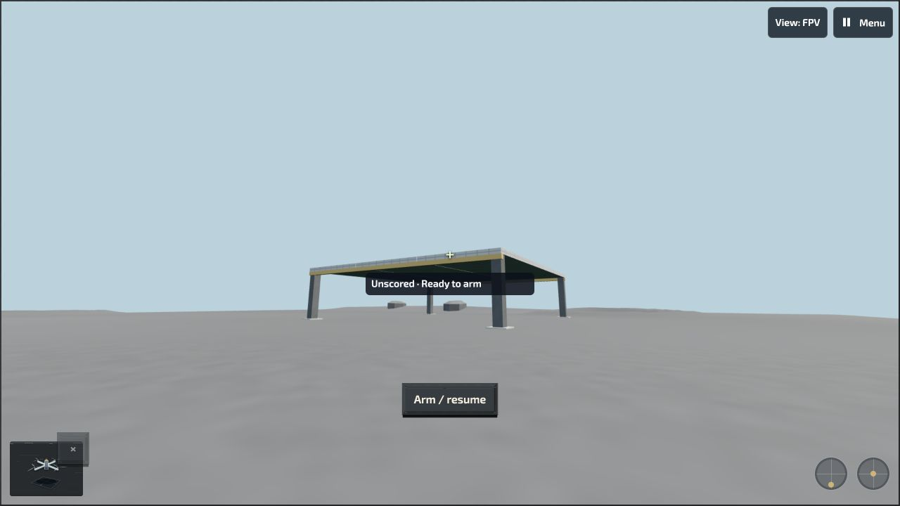
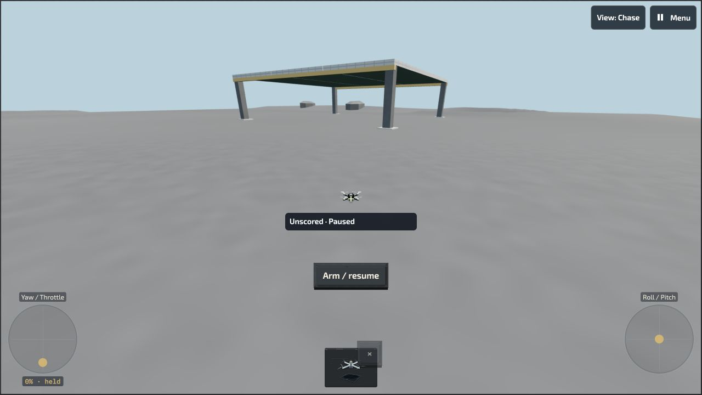
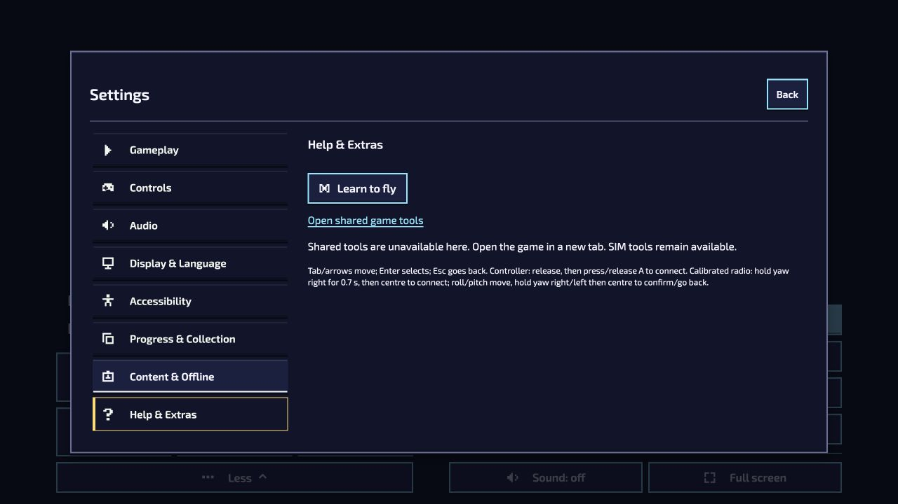

# FPV Library: bounded native observations and core-tools fallback

**Current result: bounded Library interactions and the expected absent-core fallback were observed. Complete player acceptance remains open; PR #1540 stays Draft.** Candidate: `12c3101e7e38bd1a8314da6428bf3c36a4cd85af`; package revision: `b6d25d6cc980a6b84b17d97dfd9740948edd860ea23bcc531f414962a0e34953`.

Root used CUA and one renderer at a time, ordinary player controls and a preserved loopback origin at **1280 × 720** on 17 October 2026. The initial Library session ran at 21:42–21:50 UTC; the 21:57–21:58 follow-up checked only Settings > Help & Extras. No hidden storage inspection, reset, repeated map download, product change or new build occurred in the follow-up. The affected public storage context was untouched. [Earlier package/software qualification](../fpv-library-combined-12c-20261017/README.md) remains separate; its pre-staging snapshot precedes these observations.

## What was observed

- **10 family cards / 24 offered editions** were reachable through Versions. This joins the initial full AX tree and expansion diff, not one screenshot or 24 flights.
- Normal Lunar downloads saved older `composition-r2` (edition `1ec74a07`) and newer `composition-r3` (Shelter detail). Both remained separately actionable. Final focus returned to the corresponding exact-row Fly control; temporary page focus while busy is retained.
- Tab reached Remove-this-version without activating removal. Enter collapsed and reopened Versions. AX records establish resulting states; exact actions rely on root interaction provenance.
- The older version reached **Ready to arm**. Explicit Arm briefly activated flight; Pause opened its menu. Self-level → Acro loaded a new attempt that remained Ready to arm. Touch and Chase selections stayed paused; Escape returned to a paused viewport. Selecting Touch is not physical-touch acceptance.
- English UI and Ukrainian Signal Blue settings were observed; SIM appearance followed the global theme. Normal same-origin tab close/reopen retained both Lunar versions with separate Fly actions, without reset/import/removal.

The [native review](records/INDEPENDENT-NATIVE-RECEIPT-REVIEW.json) binds the detailed AX/images. Some AX records are incremental diffs. Initial-ready and Acro-ready records have identical bytes and are not independent visual proof; separate mode-change records support the transition. Selected edition identity is UI-label binding, not hidden payload verification. [Saved-version](records/lunar-both-saved.jpg) and [reopened Ukrainian Library](records/reopened-library-uk.jpg) images show scrolled portions, not complete inventories.

## The 404 and its scoped classification

The initial HTTP log has 324 requests: **162×200, 160×304 and 2×404**, plus two error-message rows. Failed requests were `/favicon.ico` and `/revealline/game/ui/global-settings-tools.mjs`. Empty warning arrays do not prove resource success. [Original v1](records/ROOT-NATIVE-OBSERVATION-RECEIPT.json) is retained; [v2](records/ROOT-NATIVE-OBSERVATION-RECEIPT-v2.json) added those negatives and correctly held broad settings acceptance while the cause was unknown.

The later [classification receipt](fallback/ROOT-FALLBACK-CLASSIFICATION-RECEIPT.json), [exact source excerpts](fallback/exact-source-excerpts.json) and [independent supplement review](fallback/FALLBACK-INDEPENDENT-REVIEW.json) establish that this literal lazy import crosses an intentional installed-core boundary. Optional SIM archives exclude the core module; the catch renders a visible fallback. The follow-up showed the known-return fallback in **English and Ukrainian**, including the shared-tools link. No Library-source or optional-package defect is established by this expected absent-core request; no code fix was made.

[Ukrainian fallback](fallback/fallback-visible-uk.jpg) and both AX observations are included. The follow-up log retains **160×304 and one module 404**, plus its error-message row. No failed request is relabeled successful. The shared-tools link was **not opened**: its destination, installed-core features and the no-known-return branch remain unqualified. Source hashes/excerpts were recorded by root; the independent supplement review reused that bounded source review without rereading source or replaying the UI.

## Limits and retained negatives

Responsive 390×844, 844×390 and prescribed 1280×800 layouts, 44 px targets, broader themes/full-player behavior, unfamiliar retained IDs, physical controls, School/HUD, complete mode/input/start/camera coverage and public install/flight remain open. So do all-24 coexistence, quota/eviction, process restart, offline behavior, original public storage failures, actual two-hour endurance and final art. These local observations do not close them.

The initial role-selector mismatch, busy focus, both original 404s, follow-up 404 and original uncertainty remain intact. Both owned servers stopped intentionally with **EXIT130 / KeyboardInterrupt**, not test EXIT0. Closure receipts record tabs closed; the first packet lacks a separate final tab-inventory snapshot. The first projection attempt stopped before copying/publication when its fixed directory guard encountered newly added v2; its negative and empty partial stage remain preserved. All tabs/servers for these sessions are closed. No public promotion or all-plan completion is claimed.

## Public evidence mapping

The publication contains **57 original records plus this README and `REDACTION-MAP.json`**. Two server-intent copies replace one private stage path each with `<external-native-stage>`; 55 record bodies are unchanged. Four original `.png` files contain JPEG/JFIF bytes: public copies use `.jpg` with unchanged bytes and explicit filename/hash mappings. The two later JPEGs retain their original names. Original manifests still describe raw filenames/hashes, not renamed public paths. Raw records, v1/v2 and independent reviews are retained. Localhost URLs identify the test origin, not public launch URLs. No runtime archive, browser profile or player-database payload is published.
