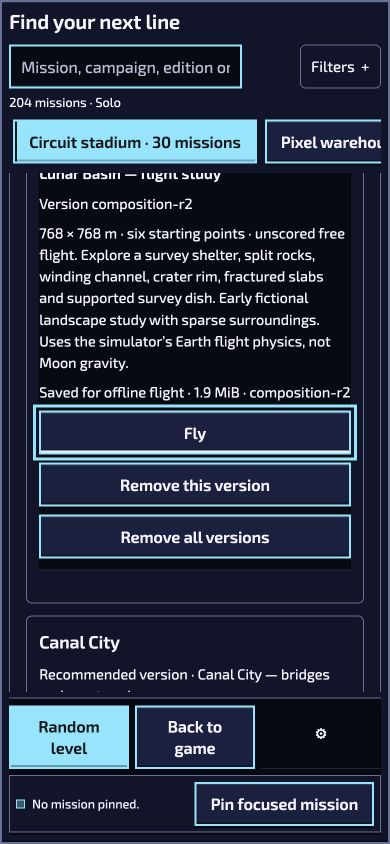

# FPV Library: responsive and saved-edition observations

**Scoped UI observations only: continuous storage-headroom compliance is not established. PR #1540 remains Draft.** This report binds candidate `12c3101e7e38bd1a8314da6428bf3c36a4cd85af` and package `b6d25d6cc980a6b84b17d97dfd9740948edd860ea23bcc531f414962a0e34953` to the recorded CUA session on 17 October 2026. No product source changed.

The [root receipt](records/ROOT-RESPONSIVE-OBSERVATION-RECEIPT.json) must be read with the separate, unchanged [headroom supplement](records/ROOT-HEADROOM-LIMITATION-SUPPLEMENT.json) and [independent review](records/RESPONSIVE-INDEPENDENT-REVIEW.json). Its PASS label alone is not full compliant-window acceptance. The last above-floor sample was **3,380,666,368 bytes at 22:18:04Z**; the post-close sample was **3,170,197,504 bytes at 22:21:08Z**, below the 3 GiB floor by 51,027,968 bytes. No sample covers that interval. Crossing time and cause are unknown, and isolated earlier samples do not establish continuous compliance. Further renderer/native/heavy work is held until renewed stable headroom is established.

## Directly observed UI facts

Six DOM-measured CSS samples covered these pairings at standard text size:

| CSS viewport | English / Signal Blue (`legacy`) | Ukrainian / Flight Deck (`industrial-workshop`) |
|---|---|---|
| 390×844 | Older Fly focused; 44 px high; center hit visible | Older Fly focused; 44 px high; center hit visible |
| 844×390 | Older Fly focused; 44 px high; center hit visible | Older Fly focused; 44 px high; center hit visible |
| 1280×800 | Older Fly focused; 44 px high; center hit visible | Older Fly focused; 44 px high; center hit visible |

The common measured control is the exact saved **Lunar `composition-r2` Fly** action, with width at least 196.796875 CSS px and recorded visible focus. This is not a 44 px/focus pass for every Library control. Document, chooser and regional container scrollWidth equaled clientWidth in these samples. The campaign rail intentionally scrolls horizontally; card text and neighboring controls can be clipped within the short content pane. Normal scrolling and keyboard navigation remain necessary. No claim is made that an entire card or all controls fit at once.

The eight unmodified JPEGs include the six focused samples, a Versions view and the saved launch. CSS dimensions come from the DOM metrics, not an inference from screenshots. Only these two locale/theme pairings were observed; other pairings, large text, contrast conformance and physical devices are unqualified.

After a normal fresh-tab reopen at the same preserved loopback origin, the exact previously saved older Fly action showed loading and then **Ready to arm**, with paused pose, zero vertical speed and drift. The menu recorded Acro, Touch and Chase. No Arm or download action was invoked in this window. Identity is visible edition/revision/action binding, not an independent saved-payload hash or hidden-storage inspection. The original affected public storage context was untouched.

## Preserved limitations and negatives

- Initial `portrait-metrics.json` includes 49 controls, including descendants of closed details, and uses viewport intersection alone. It is retained but cannot establish broad visibility or minimum-size acceptance. The six later matrix files contain 27 filtered controls and center-hit observations; only the focused older Fly is common acceptance evidence.
- Initial Ukrainian reentry temporarily showed blank regional labels. The subsequent settled AX and DOM observations restored the edition labels before action. Both captures remain intact.
- The HTTP log retains **2×200, 160×304 and one 404**, plus its error-message row. The failed `global-settings-tools.mjs` request is the [previously classified standalone absent-core boundary](../fpv-library-native-12c-20261017/README.md); no fallback test was repeated here, and empty browser-warning arrays do not mean resource success.
- The unavailable browser-capabilities documentation lookup did not mutate the page. The recorded supported viewport procedure was used afterward.
- The owned tab closed and viewport override reset. Intentional server SIGINT produced actual **EXIT1 / KeyboardInterrupt**; it is not relabeled EXIT0 or EXIT130. No renderer/server remains active for this session.

## Still open

All-control layout coverage, full theme/language/text-size coverage, unfamiliar legitimate retained IDs, physical controllers/touch/radios, broader School/HUD/input/camera/start-point and installed-core/full-player integration remain open. Also open: original public storage cause, public install/flight, restart/offline/eviction/quota/all-24 coexistence, measured performance and actual two-hour endurance. Recorded UI facts do not establish a fully compliant testing window, full-player acceptance or all-plan completion.

## Public projection

All **39 records** are included with this report and `REDACTION-MAP.json`. Thirty-eight bodies are unchanged; the sole private stage path in `server-intent.json` is explicitly replaced with `<external-native-stage>`. All eight images are actual JPEG/JFIF with unchanged bytes and filenames. Original identities and the separate headroom supplement remain intact. Localhost URLs identify the test origin, not public launch links. No source implementation, package archive, browser profile or player-database payload is included. This small evidence publication performs no new native checks, cleanup, source/package readback or artifact download.
